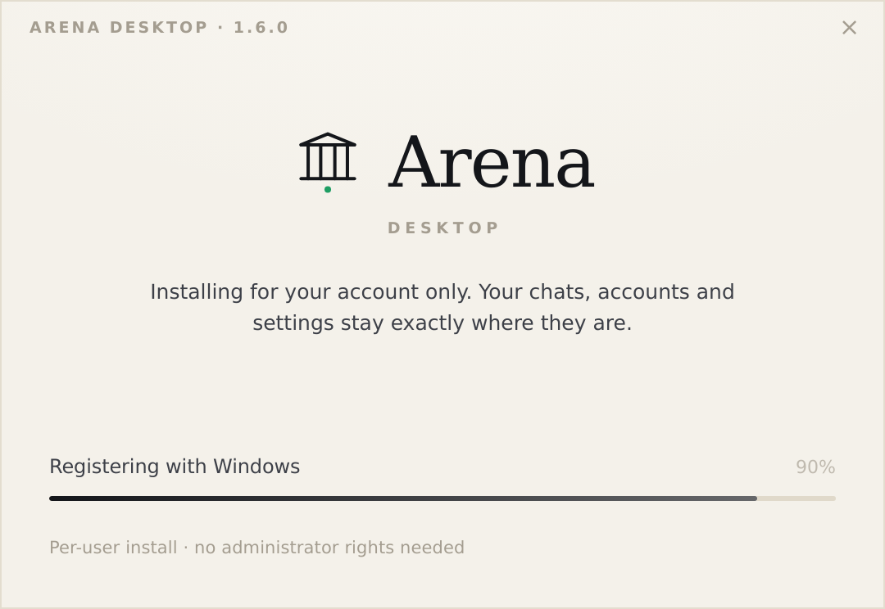
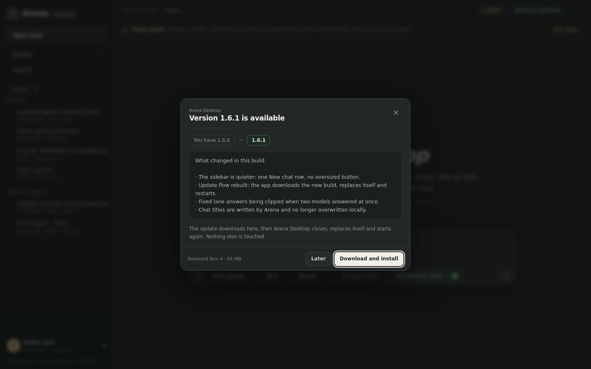

# Installing, updating and removing Arena Desktop

Arena Desktop ships as a single Windows executable that is also its own
installer. There is no separate setup framework and no per-machine service.
The release publishes that one binary under two names, and the name decides
what a double-click does.

```
Arena-Desktop-Setup-1.5.11.exe    ← double-click: installs (no admin rights)
Arena-Desktop-1.5.11.exe          ← double-click: runs, installs nothing
```

Both files are the same bytes; `-Setup-` in the file name is the switch. A
frozen build whose own file name contains `setup` or `installer` starts the
setup window; everything else starts the app. So the download behaves the way
its name promises, and the portable copy never installs anything behind your
back. Running from source (`python arena-cli.py`) is never an installer.

Scripting still uses the flags — `--setup [--silent] [--update]`,
`--uninstall [--wipe-data]` — and `--app` forces the application even from a
file called Setup.

<p align="center">
  
</p>

## Installing

1. Download `Arena-Desktop-Setup-<version>.exe`.
2. Double-click it. A single window opens: brand, one progress line. The files
   go to `%LOCALAPPDATA%\Programs\Arena Desktop`.
3. When it finishes, **Open Arena Desktop** starts the installed app — and from
   then on Windows finds it in the Start menu and in *Apps & features*.

Double-clicking the copy called `Arena-Desktop-<version>.exe` instead just runs
the app from where it sits: no shortcut, no entry in *Apps & features*, no
uninstaller. That is the whole difference between the two downloads.

| | |
|---|---|
| Location | `%LOCALAPPDATA%\Programs\Arena Desktop` |
| Admin rights | none — per-user install |
| Shortcut | Start menu (`Arena Desktop`) |
| Apps & features | `Arena Desktop <version>`, with a working uninstaller |
| User data | `%USERPROFILE%\.arena-personal` — accounts, chats, settings, memory |

Nothing is written outside those paths, and no registry keys are created except
the uninstall entry under `HKCU`.

### Portable use

Run `Arena-Desktop-<version>.exe` from anywhere without `--setup`: it starts
like before and keeps its data in `%USERPROFILE%\.arena-personal`. Add an empty
`portable.txt` next to it to keep data in `.\data` instead.

## Updating

The app checks the release feed of this repo
(`Arvex-GH/ArenaAI-Desktop-Major-Rework`) at startup and every 6 hours.

```
Arena Desktop 1.5.11 is available      ← dialog, not a browser link
[Later]  [Download and install]
```

<p align="center">
  
</p>

1. **Download and install** streams the published build into
   `%TEMP%\ArenaDesktopUpdate`.
2. The download is checked against the size and, when GitHub publishes one, the
   SHA-256 digest of the release asset. Links to anything other than
   `github.com` are refused.
3. The app closes, a second copy of itself waits for the process to exit,
   replaces `Arena-Desktop.exe` in place and starts the new version.
4. Chats, accounts, settings and memory are untouched — nothing has to be set
   up again.

`Later` keeps a small chip in the corner so the update is one click away.
Settings → About has the same actions plus manual *Check for updates*. Updates
can be disabled there entirely, and the beta channel includes pre-releases.

If a release publishes a Setup file, that file is run with `--setup --update
--silent`; if it publishes only the plain build, the in-place swap above is used
instead. Either way the installed copy is the one that ends up current.

### Why it survives an update

| Kept | Where |
|---|---|
| Accounts, cookies | `%USERPROFILE%\.arena-personal` (DPAPI-encrypted) |
| Chats | `…\.arena-personal\chats` |
| Settings, memory, MCP config | `…\.arena-personal` |
| Workspace folder | wherever the user chose |

The installer only writes inside the install folder, and never deletes the
config folder unless the user explicitly asks for it in the uninstaller.

## Removing

**Settings → Apps → Arena Desktop → Uninstall**, or run:

```powershell
& "$env:LOCALAPPDATA\Programs\Arena Desktop\Arena-Desktop.exe" --uninstall
```

The uninstaller offers one checkbox: *Also delete my chats, accounts and
settings*. Unchecked (the default) keeps user data. Silent removal:

```powershell
& "$env:LOCALAPPDATA\Programs\Arena Desktop\Arena-Desktop.exe" --uninstall --silent
```

## Building a release

The binary is built on Windows in CI (`.github/workflows/build.yml`):

1. Reads the version from `arena/version.py`.
2. Runs the test suite, so a broken build never reaches a release.
3. `python -m PyInstaller arena-cli.spec` → `dist/Arena-Desktop.exe`. The spec
   collects `arena/web/server/` by folder, so the backend parts that
   `app.py` loads by name ship with the exe instead of failing at startup.
4. Runs `Arena-Desktop.exe --version` as a smoke test.
5. Publishes `Arena-Desktop-Setup-<version>.exe` and `Arena-Desktop-<version>.exe`.

Push a tag to publish a release the updater can see:

```bash
# bump arena/version.py first, then
git tag v1.5.11 && git push origin v1.5.11
```

The tag must match `arena/version.py`; the workflow fails otherwise.

### Changing the update feed

The feed defaults to `Arvex-GH/ArenaAI-Desktop-Major-Rework`. To point a build elsewhere
without rebuilding, set it in `%USERPROFILE%\.arena-personal\config.json`:

```json
{ "update_repo": "owner/repo" }
```

or set `ARENA_UPDATE_REPO=owner/repo` in the environment.

## Code signing

The build is not signed. Windows SmartScreen will warn on first run:
**More info → Run anyway**. Signing needs a certificate; once one exists, add it
to the PyInstaller step (`signtool sign /fd sha256 …`) and SmartScreen stops
complaining.
