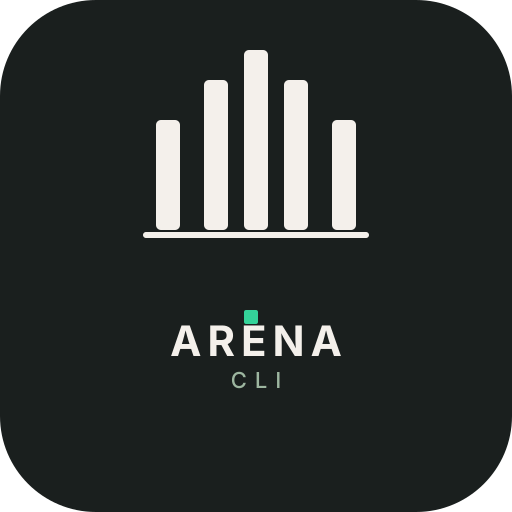
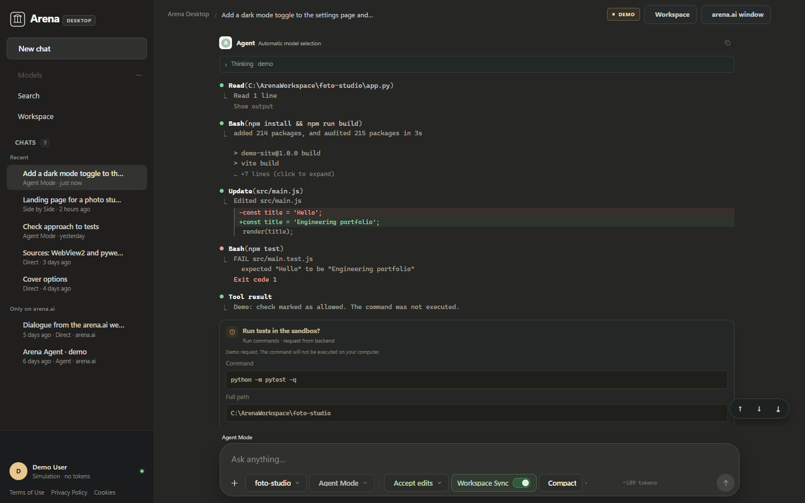
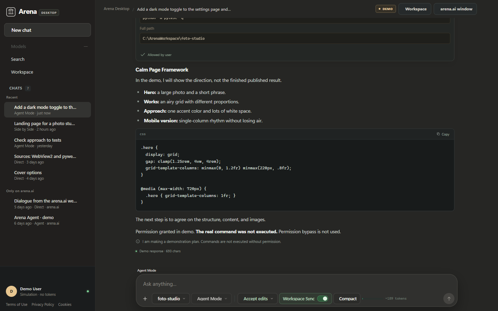
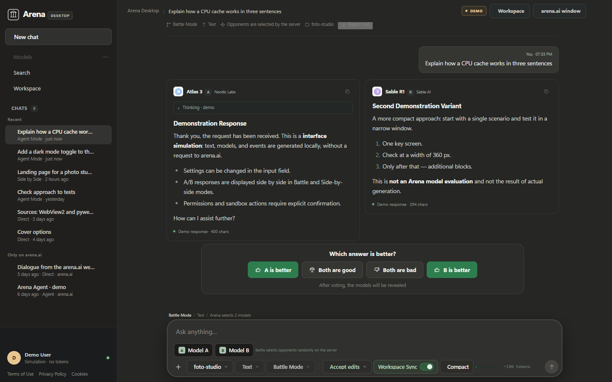
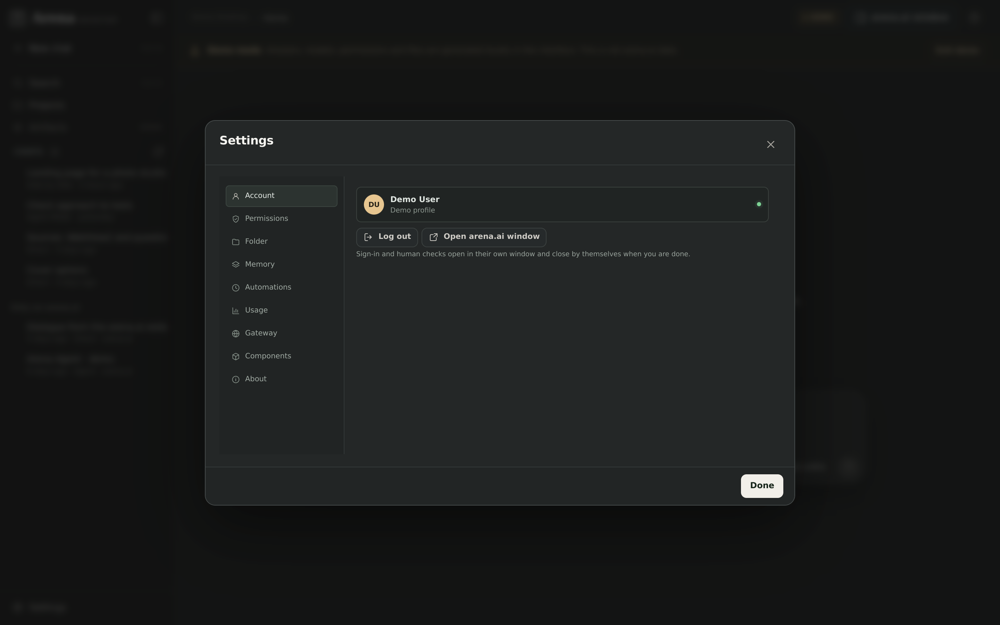

<p align="center">
  
</p>

<h1 align="center">Arena Desktop</h1>

<p align="center">
  <b>An unofficial desktop app for <a href="https://arena.ai">arena.ai</a> — chat, battles, a real Agent Mode,
  and models that can work on the files on your machine, all in one window.</b>
</p>

<div align="center">
  <a href="https://github.com/Arvex-GH/ArenaAI-Desktop-Major-Rework/stargazers"></a>
  <a href="https://github.com/Arvex-GH/ArenaAI-Desktop-Major-Rework/releases/latest"></a>
  
  
  
  <a href="LICENSE"></a>
</div>

<p align="center">
  
</p>

> [!IMPORTANT]
> Arena Desktop is an **unofficial, community-built client**. It is not affiliated with or endorsed by Arena AI Inc.
> This is for **educational Purposes ONLY**. 
> You sign in with your own arena.ai account and are responsible for following arena.ai's terms.
> The app never solves human checks for you — when arena.ai asks for one, you complete it yourself.

---

## Contents

- [Download](#download)
- [What's new in v1.5.18](#whats-new-in-v1518)
- [What it does](#what-it-does)
- [How it works](#how-it-works)
- [Repository layout](#repository-layout)
- [Run from source](#run-from-source)
- [Tests](#tests)
- [Troubleshooting](#troubleshooting)
- [Limitations](#limitations)
- [Roadmap: macOS and Linux](#roadmap-macos-and-linux)
- [Translations](#translations)

## What's new in v1.5.18

### The update button was doing two things at once

Reported from the installed app: the updater *"always gives up an error"* about an
update that is already there, and *"the progress bar also progresses and then
regresses and then progresses until she reaches the end"*.

Both came from one line. The update dialog's primary button is owned by
`setPrimary()`, which assigns `primary.onclick` on every state change — and it
also had a second `addEventListener('click', …)` from the dialog being built. One
click ran **both** handlers:

- **Download and install** started two downloads of the same file into the same
  `.part` file, and the second job reset the first — the bar fell back to 1% and
  the phase flipped under the dialog.
- **Restart and update** started the install *and* began downloading again. The
  install request could then arrive after the job had been reset to
  `downloading`, and was answered `409 The update has not finished downloading
  yet.` — a red error, with "Try again", about an update the user had just
  finished. Then the bar restarted and ran to the end again.

The second handler is gone; the button has exactly one. The install endpoint also
claims the job (`phase: installing`) before it launches anything, so a stale
second click can no longer start a download underneath the setup that is copying
the file.

**The bar can only move forward now.** The percentage is clamped in all three
places that drive it — the download job, the dialog and the setup window — and a
reordered poll answer can no longer walk it backwards (polls are also serialised,
since 450 ms apart is not the same as 450 ms of latency). A new download is the
only thing that resets it.

**"You are already on the newest version" is no longer an error.** If the feed
really does answer that — the check cache can be six hours old — the dialog says
*"This build is the newest release on the feed. Nothing to install."* with a
single Close button, and re-checks the feed so the stale "an update is available"
goes away too. Starting a download now also re-reads the feed instead of trusting
that cache.

### Previous: v1.5.17 — the folder in Chat options is a folder again

### The folder in Chat options is a folder again

Reported from the installed 1.5.16: *"the open in explorer and select folder
buttons are way to scaled up"* — with a screenshot of a 200 px folder glyph
filling the panel.

The Folder row in Chat options wraps its icon in a `span.cm-line-icon`, and
`.icon` is a plain `display: inline` span: width and height are ignored on inline
boxes, so the `svg` inside — which is `width: 100%` — resolved against the row
instead of the icon. Eighteen pixels became two hundred.

Icons inside the panel now have their own box and an explicit size: `.cm-line svg`
and `.cm-pill svg` are 14 px and 12 px, and `.cm-line-icon` is an `inline-flex`
so its child is blockified and the 18 px width actually applies. Nothing else in
the panel moved.

The harness measures it now instead of trusting the markup: `composer_menu_dom.js`
injects the real stylesheet into jsdom, opens the panel and asserts that every one
of its 21 icons computes to a glyph size (≤ 16 px) — the check that would have
caught this before it shipped. Against the 1.5.16 stylesheet it fails with
`100%`; against this one it reads `max 14px`.

### Previous: v1.5.16 — a run of tool calls is one line you can open

### A run of tool calls is one line you can open

Reported after 1.5.15: a busy turn is a wall of rows — read, read, write,
command — and there is no way to see it as one paragraph of work. Now it is one.

Consecutive tool calls between one thought and the next — and between two
paragraphs of the answer — are a group: a single row that counts what the run
did, with every call one click behind it.

```
Thought for 3 seconds
> 2 reads, 1 write, 1 command        4 calls
> 2 reads, 1 write, 1 command        (folded)
```

- **Open by default.** The rows are exactly the rows that were there before,
  one hairline further in; a click on the summary line folds the whole run, and
  the choice is remembered for that group.
- **The counts are the three things you asked for** — reads, writes, commands —
  in a fixed order, singular when it is one (`1 read, 1 write, 1 command`), and
  zero categories left out. Searches, fetches, MCP tools and sub-agents are
  counted as *tools* rather than being passed off as a read or a write.
- **Boundaries hold.** A thought row ends a run, and so does a paragraph of
  answer text; a group never spans either.
- **One call is not a group.** "1 read" over a row that already says *Read
  app.js* would say it twice, so a lone call stays exactly as it was.
- **While a run is live** the summary line carries the spinner instead of a call
  count. A group you folded by hand stays folded — the spinner is what tells you
  it is still working.
- **A pending approval is never folded away.** If one of the calls in a run is
  waiting for your decision, the group opens itself, says *waiting* in amber, and
  refuses to close. Everything else the view may hide; a question to you it may
  not.

Nothing about the calls themselves changed: the rows keep their own chevrons,
their own output, their own approval prompts and their own place in the sentence.

### Previous: v1.5.15 — thought rows, a bypass that does not ask, the agent in the composer

### The composer is two icons, and the agent is one click away

Four things reported from the installed app, all about the row under the message
box and what happens before you type in it.

**Thinking reads like a tool call.** A reasoning block used to be a separate,
quieter species of box — a *Thinking* label, grey italic prose, a different
border. It is a tool row now, the same one that says *Ran commands 1*: a chevron
on the left, a glyph, one line of text, and the prose folded underneath. While
the model is thinking the row says `Thinking…` with a spinner; when it stops the
same row says `Thought for 3 seconds`, and clicking it opens the same text it
always held. Nothing about the reasoning changed — only the drawer it lives in.

**Bypass means bypass.** With *Bypass permissions* selected the agent still
stopped to ask about ordinary shell syntax (`npm i && curl …`, `%VAR%`,
`python -c`), inline code and paths outside the folder. Those rules were written
for the modes that *do* ask, and they were reached before the bypass check. Now
bypass is answered first and answered with **allow**: the only thing that can
stop it is a denial, and the only denials left are the catastrophic ones
(`rm -rf /`, a fork bomb, `mkfs`). The mode note says exactly that.

**Local or Cloud agent, from the composer.** The agent backend — *Local agent*
(arena.ai's tools on this PC) or *Cloud agent* (arena.ai's own agent, its cloud
workspace) — used to live three levels deep in Settings → Permissions, together
with a duplicate of the permission radios. That panel is gone. Both backends are
now a row in the composer's Chat options, one click, remembered for the next
launch.

**The toolbar is two icons and Send.** The six text chips (mode, work type,
folder, Workspace Sync, compact, gateway) are inside a single **Chat options**
button — three dots, left of `+`, with a tooltip. `+` stays, the bypass dot and
Stop stay next to Send, and nothing in the row is text. A small dot on the menu
button reports a permission request waiting for you, or a bypass that is on.

### Previous: v1.5.14 — no box around a reply, no waiting for connectors

### The first answer no longer waits for the connectors

Reported after 1.5.13: the connectors were up at launch, yet the first prompt of
a session took a long time before the model said anything — *"i think that the
mcp connects under the hud again"*. It did.

Every local reply runs the tool loop, and its first line asked the connector
runtime to *make sure everything is started*. That meant connecting **every**
enabled connector, one after another, waiting up to thirty seconds for each. So
a prompt sent while the launch run was still spawning `npx` servers stood in
line behind them — and a connector that had failed at launch was started again
from scratch on *every* turn, without a word.

Nothing about that belongs on the path of an answer. A reply now takes the tools
that are up at that moment (`tools_now()`), waits one courtesy second for
anything mid-spawn, and — if one really is late — says so in a single line
instead of quietly answering without it: *"Filesystem was still starting when
this message went out, so this reply works without its tools. They join your
next message."* The next reply carries the new tool guide by itself.

A connector that failed is retried in the background, once a minute, off the
request thread. The launch run itself now spawns all of them at once instead of
one after another, so the start-up screen ends in the time of its slowest
connector rather than their sum, and switching a connector on in Settings
connects it straight away.

### Previous: v1.5.13 — every connector in the launch list

### The app's own connectors are in that list too

Filesystem, Memory, Sequential Thinking, Time, Fetch, Git — the built-in presets —
are installed *into* `mcp.json` like any other connector, so they are started by
the same launch run and appear in the same progress list. They keep their proper
names there now (*Sequential Thinking*, not `sequential_thinking`), and a preset
you switched off shows as **Off** instead of quietly vanishing from the list.

### The app opens its own connectors

Launching the app used to open a console window per local MCP server and connect
none of them: the servers only started when a turn happened to need one, so the
right bar (or the AI, if you asked it something) was the only way to wake them.
Three connectors meant three black windows and a panel full of *stopped*.

They are background processes now — no window, no taskbar entry — and every
enabled connector connects by itself as the app opens.

### A start-up screen that says what is happening

The window no longer sits there pretending nothing is going on:

1. **Opening Arena Desktop** — the local server;
2. **Connectors** — one row per local MCP, *Waiting… → Connecting… → 12 tools*,
   with the progress bar filling as each one arrives;
3. a connector that fails is named **on the screen**, with its error, and a
   **Retry** button; *Continue in the background* and Esc get you in regardless.

It closes itself a second after the last connector is up.

### Saved accounts back, in Settings

The account switcher lived in the left rail's pop-up, and hiding the rail took it
with it: switching accounts meant logging out and back in with cookies. Settings →
**Account** now lists every saved account — avatar, name, address, which one is
current — with **Switch**, **Forget**, and **Add another account**. Each account
keeps its own session, chats and models; switching takes a second and needs no
sign-out. An expired session says so and offers *Sign in again* instead.

### The answer that vanished, and the `~~~` that printed itself

A battle with two agents exposed the marker parser. On one side the model fenced
its calls with `~~~command` but **never wrote the closing `~~~`**: the next
call's opening marker was eaten as the previous call's closer, and the last call
then hid everything after it — the answer included. The card showed three
commands, no reply, and "Response received · 29 chars": the length of the
sentence it managed to say before the first call.

On the other side the model glued the closing marker to the answer —
`~~~Hi Urja, your PC has one drive…` — which is not a marker line by the old
rules, so the tildes printed themselves into the chat. The same turn cut a
sentence in half (`Used: abo` … `ut 207 GB`) because a row's place in the answer
was measured by re-parsing the text up to that row, which hides things
differently than the whole reply does.

The rules are now:

- a marker is a token at the start of a line: `~~~` plus a known kind **opens**
  a call, a bare `~~~` **closes** one (only once the call's tag has closed);
- a kind marker while a call is open closes that call at its own tool tag and
  starts the next one — models that never fence their calls cannot eat them;
- a closing marker glued to prose (`~~~Hi Urja…`) hides the call and the tildes
  and keeps the words;
- a call left unfenced when the turn ends hides the call, **not** the answer
  after it;
- a row's place is measured with the same hiding the text went through
  (`offsetMapper`), so a sentence is never cut in the middle of a word.

### The first sentence, printed twice

While the placeholder is up it *is* the prose — that is the point of it. The 1.5.9
rewrite that placed thoughts in the flow poured the text into the card as well,
so during the first moment of a turn the opening sentence appeared twice: once as
text, once as the placeholder under it. The placeholder branch renders rows and
thoughts only now, and a test check pins it down.

### The model thinks in a block, not in your answer

Agent turns used to end with the model narrating its own process into the reply —
*writing out loud*, as it were: *"We now have the disk layout. Let's write a
concise breakdown…"*, sitting above the breakdown it was describing. Plans,
self-checks and notes like *"let me double-check that"* are not the answer, and
reading them back as if they were was noise.

Those thoughts are wrapped in a `<thinking>` block now and streamed inside a
collapsed **Thought** line, at the point in the turn where they happened —
between the paragraph above and the paragraph below, never hoisted to the top of
the card. While a block is still arriving it stays open with a caret so you can
watch it think; the moment it closes it folds to one line. A half-arrived
`<thinki` never flashes as text.

### "Exploring solutions…" belongs where the words will be

The placeholder that stands in for a reply used to hang at the top of the card
for the whole turn. An agent that ran six commands sat under a line still saying
*exploring solutions…* — text about a moment that had already passed, above work
that was happening now.

The rows come first now and the placeholder sits at the bottom, under the last
row, where the next words will actually appear. When the model writes, it is
replaced by the text; between calls it simply marks that the turn is still going.

### Previous: v1.5.7 — commands visible while they run

<details>
<summary>1.5.7: the rows stream under the placeholder instead of appearing when the turn ends</summary>

### The command you are waiting on is on screen

While a turn had no prose yet — only tool calls — the answer area showed the
"Thinking…" placeholder and nothing else, so every command the assistant ran was
invisible until the turn ended (or you pressed Stop) and the rows appeared all at
once. With 1.5.6 the extra `Allowed …` line stopped covering for it, and the
commands went quiet.

The work is drawn while the placeholder types now: the rows stream under it, the
running one open, exactly as they do once prose arrives.

</details>

### Previous: v1.5.6 — one verdict per command

<details>
<summary>1.5.6: granted approvals stopped echoing themselves into the thread; a refusal is red, on the command's row</summary>

### One verdict per command, and only when it is "no"

An approved command used to leave two lines in the thread: the row that says
`Bash powershell -NoProfile -Command "Get-Volume"` with its `exit 0`, and a
second silver line reading `Allowed powershell … allowed`. On a turn that ran
three commands, half the thread was the app agreeing with itself.

The granted-approval line is gone. The command row is the record. A refusal is
the only verdict that still gets a line, and it sits on the command's own row —
the same 10px line, in red, right behind the command:

```
● Bash powershell -NoProfile -Command "Remove-Item .\*"   rejected by user
```

If the reply was stopped before a command ran, or the approval expired
unanswered, the row says `not run: …` instead of pretending the user refused.

</details>

### Previous: v1.5.5 — the Setup window shows the install

<details>
<summary>1.5.5: the setup page picks up the pywebview bridge and drives the install itself</summary>

### The Setup window shows the install again

1.5.4 stopped the installer from hanging — but by giving up on its own window:
after twelve seconds a watchdog took over and installed in the background while
the window sat on "Starting…". The window itself never received the bridge that
drives it.

pywebview injects `window.pywebview.api` about a second and a half after the
page loads, and announces it with a `pywebviewready` event on **window**. The
page listened on `document`, and its single fallback check ran at 900 ms — both
missed, every time. Now the page listens on both targets *and* polls until the
bridge appears, then asks it to start: real progress, phase by phase, from the
first second. The watchdog is still underneath as the last resort, and if the
bridge genuinely never arrives the page says *"finishing the install in the
background"* instead of animating a fake install.

A headless regression harness (`tests/js/setup_page_bridge.js`, jsdom) covers the
three arrivals: at load, late with the event on `window`, late with the event on
`document` — plus the no-bridge case.

</details>

### Previous: v1.5.4 — bypass permissions and the frozen Setup window

<details>
<summary>1.5.4: the KeyError in bypass mode, the setup window that stopped hanging, and setup.log</summary>

### Bypass permissions stops killing the reply

With *Bypass permissions* selected, every message died before the model was
called: **KeyError: 'bypassPermissions'**. The agent guide knew four of the five
permission modes, and the fifth — the one whose whole point is "run it now" —
was the missing one, so the turn crashed while it was still being built. The
mode is in the guide now, an unknown mode falls back to the default text
instead of raising, and a test keeps `permissions.MODES` and the guide in step.

### The Setup window no longer freezes

1.5.3's installer opened its window, printed "Starting…", and then hung until
Windows greyed it out — the install never began. pywebview builds a page's
bridge by walking every public attribute of the `js_api` object; the setup
window kept its window reference in a public `window` attribute, so the walk
went from the bridge into the WinForms form and the WebView2 objects behind it
and deadlocked the message pump. The app itself already knew this rule (its
bridge documents it and keeps `_window`), which is why only the installer froze.
The reference is private now, and two safety nets came with it: a watchdog that
starts the install from Python if the page has not called the bridge within
twelve seconds, and `%USERPROFILE%\.arena-personal\setup.log`, so a setup
window that ever misbehaves leaves a trace.

</details>

### Previous: v1.5.3 — the Setup file installs

<details>
<summary>1.5.3: the double-clicked Setup file installs, and a failed reply explains itself</summary>

### The Setup download installs

1.5.2 shipped both files but only `--setup` opened the installer, and a
double-click passes no arguments: the file called *Setup* simply started the
app. Nothing went into `%LOCALAPPDATA%\Programs\Arena Desktop`, no Start-menu
shortcut appeared, *Apps & features* knew nothing about it, and Windows search
found a stray exe instead of an app.

The file's own name is the switch now. **Double-click
`Arena-Desktop-Setup-<version>.exe` and it installs** — per-user, no admin
rights, Start-menu shortcut, uninstaller, and from then on the app updates
itself. `Arena-Desktop-<version>.exe` still just runs, which is what the
portable download is for. `--app` forces the app from either file; running from
source never installs.

### A failed reply explains itself

A crash inside a reply used to say only *The app hit an internal error.* — no
exception, and no traceback anywhere. The row now shows the exception under the
message with *Copy details* beside it, and the full stack goes to
`%USERPROFILE%\.arena-personal\desktop.log`. Two unguarded calls into the
WebView2 bridge that could kill an Agent turn before its first character now
read as "the arena.ai window is not ready" instead.

</details>

### Previous: v1.5.2 — the rework itself

<details>
<summary>The first release of the rework: the rail, the one-line tool rows, the Settings row, the installer</summary>

The interface was rebuilt around the things you actually do — pick a mode, type,
watch the work happen. What is deliberately still missing is listed in
[docs/REWORK.md](docs/REWORK.md).

### A quieter sidebar

One column of rows instead of boxes: **New chat**, **Search**, **Projects**,
**Artifacts**, then your chats. Small caps for section labels, hairlines for
structure, no cards. The rail collapses to 76px of icons and comes back.

The account block and the footer's icon row are gone; both live behind a single
**⚙ Settings** row pinned to the bottom of the rail, where the chat list always
ends in the same place. *Terms of Use*, *Privacy Policy* and the cookie policy
moved into **Settings → About** next to the GitHub link, so the rail does not
end in small print.

### The conversation: one line per call

A tool call is one silver line — `Bash npm install && npm run build`,
`Writing src/hero.js` — and nothing else. It expands while it runs, folds itself
when it finishes, and can be opened by hand at any point. No parentheses, no
boxed cards, no wall of command output in the middle of an answer.

Before a call is written, the model announces it with a marker line
(`~~~command`, `~~~write`, …). The app hides that block from its first character
and shows the one-line row in its place, so a half-written tool block never
scrolls past.

### A real installer, and updates that install themselves

`Arena-Desktop-Setup-<version>.exe` installs for the current user without admin
rights: Start-menu shortcut, an entry under *Apps & features*, a working
uninstaller, and no wizard — one window with the brand and a single progress
line. The app then keeps itself current: it checks the official release feed,
offers one dialog (*Download and install*), verifies the download against the
published size and SHA-256, replaces its own executable and restarts. Accounts,
chats, settings and memory are never touched, so nothing has to be set up again.
See [INSTALLER.md](INSTALLER.md).

### The right-hand column is gone

The Workspace/Connectors panel is removed for this rework. Choosing a folder
still works from the composer chip and Settings → Folder.

### Reliability fixes from 1.5.1

- **Chats stay apart.** A reply keeps the folder it started in, opening a chat switches back to its folder, and an approval request shows only in its own chat.
- **No double sends.** When the connection drops after arena.ai took a message, the app reads the reply from arena.ai's copy of the chat instead of sending the prompt again. Sending twice used up arena.ai's per-chat token limit.
- **Clear errors.** A full arena.ai session, an "I'm not a robot" check and an arena.ai outage (from status.arena.ai) are named as such. Text chats continue in a fresh session when one fills up.
- **Run on this PC.** The ▶ button in the Workspace panel installs a Code-mode project's packages, starts its dev server, shows the address and stops it on request. Dev servers the agent starts show their address in the chat.
- Cleaner text between tool steps, and Refresh from Arena fixes replies that were cut off or glued together.
- **Account menu.** The menu shows who is signed in, then the saved accounts to switch to. Switching, signing out and signing in with cookies show each step as it happens.
- **Old chats read like new ones.** Chats from before 1.5 show their tool calls as rows with their output, instead of raw tags, and Code-mode steps keep their output.
- **Chats stay in place.** Opening or importing a chat no longer moves it to the top of the list.
- **Previews open in the app.** The Preview button on a live site opens the app's preview window. Before, an error sent it to the web browser instead. Closing the window only hides it.
- **arena.ai outages are shown.** The app reads status.arena.ai. When arena.ai reports trouble, a bar at the top names the problem and links to the status page. While arena.ai fails, the sign-in check no longer says your session expired. Settings → About → Quick diagnostics has a new "Arena.ai service status" row, and failed checks now show why. The encryption check no longer always fails.

</details>

### Previous: v1.5.0

<details>
<summary>What was new in v1.5.0</summary>

#### Arena Agent files land on your computer

With Workspace Sync on, every file the Arena Agent writes, edits or deletes in arena.ai's cloud workspace is copied into your chosen folder as it happens. This covers its file tools and `cat > file << 'EOF'` heredocs in shell commands. It asks once per chat, follows the permission mode, and never overwrites or deletes a file you changed on this computer. Dependency folders (`node_modules`, `.git`) are skipped. An HTML file it saves gets a live local preview.

### Site previews

Preview links are now `/preview/<key>/index.html`, using a read-only key separate from the API token. Linked CSS, JS and images load too, and "Open preview" no longer ends in `Missing or invalid API token`. arena.site links from Arena (Code mode and Agent) show as a "Live site" card with Preview, Copy link and Browser. In the desktop app, Preview opens its own WebView2 window: arena.site pages refuse to load inside frames, so an in-page iframe cannot show them.

### Smaller fixes

- Opening a chat no longer pulls Arena's copy of your injected memory, tool guide and tool results into it. Those used to show up as extra turns, so chats looked mixed together. Opening a chat no longer moves it to the top of the list.
- Cold start shows "Connecting to arena.ai…" with your saved account, then loads history and models by itself. You no longer need to refresh.
- Chat titles Arena copied from the injected guide ("[Arena Desktop] The user is…", "[System] You are Arena CLI…") are replaced by a summary of your first message.
- The first-run setup checks your account against the Direct model list. Battle mode has no model list, so the old check was wrong.
- Connectors: Arena connectors and local MCP servers are separate groups, and `mcp.json` sits next to the local group.
- The message jump control stays inside the chat column and no longer duplicates "back to bottom".
- Tests run against a temporary config folder (`ARENA_CONFIG_DIR`). They used to add fake accounts to the real `~/.arena-personal`.

### Claude Code–style tool rows

Agent tool calls render as compact terminal rows instead of boxed cards: `● Bash(npm install && npm run build)` with the result underneath (`⎿ added 214 packages…`). Green dot = done, red = failed (with the exit code), amber = waiting for your approval, blinking = running. Long output folds to 4 lines with "+N lines (click to expand)"; reads, listings and searches show a one-line summary ("Read 120 lines", "Found 8 matches"); edits show a coloured diff. Arena Agent's JSON tool input/output (`{"command": …}`, `{stdout, exitCode}`) is unwrapped into the same format. The header status reads `✻ Running command… 12s` / `✻ Thinking… 3s`, and the tool input and output are now saved in chat history, so reopened chats keep them.

### Run npm / cmd commands on your computer

In Agent mode with a local folder, `run_cmd` now supports full shell syntax through `cmd.exe` (or `/bin/sh`): `npm install && npm run build`, pipes, redirects and `%VAR%`. Output streams live into the tool row while the command runs, and Stop kills the whole process tree. Dev servers and watchers can run in the background (`<background>true</background>`): the agent gets the first output and the local URL, the process keeps running, and `stop_cmd` (or closing the app) ends it. Package managers and builds get a 180 s silence limit instead of 30 s.

Safety: a command that uses shell syntax or inline code (`-c`, `-e`, `--eval`) is never auto-approved. You confirm each one, even after "Allow such actions in this session" and in every permission mode. Catastrophic commands stay blocked.

### Usage bar

Live usage indicator above the composer shows how much of your daily arena.ai limit is used. Piggybacks on ratelimit headers — zero extra API calls. Three color states: blue (normal), amber (70%+), red (90%+). Reset countdown shows when limits refresh.

### Typewriter loading phrases

The typewriter animation ("asking Terry", "beam searching", etc.) now reliably shows during the loading window before text arrives, with a minimum 1.8s display window to prevent flicker. The animation used to stop before typing a single letter (it checked that it was on the page before it had been attached); it now survives the chat re-rendering on every stream event.

### Modular JS codebase

`app.js` split from one 11,316-line file into 14 source modules in `js/`, each under 1,500 lines. Concatenated into `app.js` by `python scripts/build-js.py`. Same IIFE, zero runtime change. Only the frontend is split so far: the backend `arena/web/app.py` (about 8,000 lines: Flask routes, chat and agent loops, the Arena Agent stream, uploads, workspace) is still one module, and splitting it into smaller files is planned for the next release.

</details>

### Previous: v1.4.0

<details>
<summary>What was new in v1.4.0</summary>

- Shell builtins (`echo`, `dir`, `ver`) now work in the terminal
- 8 security findings patched from a full code audit
- 46 feature tests + 22 security verification tests all pass
- **CRITICAL:** Settings import filtered — crafted settings files can no longer inject `permission_mode` or `gateway_auto`
- **HIGH:** Upload and workspace panel block sensitive dirs (`.git/`, `.ssh/`, `.env/`)
- **MEDIUM:** SSRF hardened, terminal scoped to workspace, agent symlink check added
- **LOW:** Error messages sanitized

</details>

### Previous: v1.3.0

<details>
<summary>What was new in v1.3.0</summary>

- **Workspace file reading** — AI models can read, list, browse files in workspace
- **Typewriter loading animation** — 30 random phrases with typing/erasing effect
- **Rate limit reference** — all 8 known arena.ai rate limits documented in Settings
- **Chat replay fixed** — system prompts filtered from visible messages
- **Send button arrow** — missing CSS class fixed
- **About dialog logo** — colosseum logo instead of star
- Upload endpoint unblocked, caps enforced, null bytes stripped, preview CSP updated

</details>

### Previous security work (v1.2.0-alpha → beta, carried forward)

<details>
<summary>22 findings fixed in v1.2.0</summary>

- `/api/token` removed — secret injected via `<meta>` tag instead
- DPAPI encryption for cookies and credentials (Windows; other platforms planned)
- Agent sandbox blocks `.ssh`, `.aws`, `.gnupg`, `.env`, `.git`, NTFS ADS, symlink escapes
- `contracts.json` locked to existing API path keys only
- SVG data-URI XSS blocked (raster-only)
- "Always allow" resets per chat
- Automations locked to plan mode
- Per-launch API token on all `/api/*` endpoints
- Workspace scoped to projects directory
- Settings allowlist
- Inline code blocking on agent commands
- `shell=False` on all subprocess calls
- `/api/terminal` hardened — `shell=False`, `shlex.split`, 30s timeout, workspace-scoped, token-gated
- Security headers on index and static routes

</details>

> [!NOTE]
> Report issues on the [issues page](https://github.com/Arvex-GH/ArenaAI-Desktop-Major-Rework/issues).

## Download

Every build is on the [releases page](https://github.com/Arvex-GH/ArenaAI-Desktop-Major-Rework/releases/latest).

| Platform | Download | Notes |
| --- | --- | --- |
| Windows 10 / 11 | `Arena-Desktop-Setup-<version>.exe` | Installs for the current user (no admin rights) and keeps itself up to date. |
| Windows 10 / 11 | `Arena-Desktop-<version>.exe` | Portable — run it from anywhere, nothing is installed. |

Both need the Edge WebView2 runtime (built into Windows 11).

**Install** — double-click the Setup file, wait for the one progress line, press
*Open Arena Desktop*. It lands in `%LOCALAPPDATA%\Programs\Arena Desktop`, adds a
Start-menu shortcut and a proper entry under *Apps & features*.

**Updates** — the app checks the official releases itself and offers a single
dialog: *Download and install*. It replaces itself in place and restarts; chats,
accounts and settings stay exactly where they are. Nothing has to be set up again.

**Uninstall** — *Apps & features → Arena Desktop → Uninstall*, with an opt-in
checkbox if you also want your chats and settings removed.

See [INSTALLER.md](INSTALLER.md) for the full picture (silent flags, update
feed, signing, release process).

If Windows SmartScreen warns: click **More info → Run anyway** (the build is not code-signed).

## What it does

- **Every arena mode in-app** — I built in Battle, Side by Side, Direct, and Agent Mode so you don't need a browser tab.
- **Every modality** — Text, Image, Web Search, Code, Video, Auto (same rules as the website).
- **Workspace Sync** — models can list, read, write, edit files and run commands in a folder you choose, under a permission mode you control.
- **Files land on your PC** — files the Arena Agent writes in its cloud sandbox are copied into your folder as it works, and `arena.site` links open in an in-app preview.
- **MCP servers + Arena connectors** — local MCP servers (presets, JSON, CLI) and official Arena connectors with per-connector toggles.
- **Multi-account** — switch arena.ai accounts in one click, parallel chats, local + cloud history.
- **Agent Gateway** — the genuine Arena Agent can use your local MCP servers and workspace folder through a pairing-protected tunnel.
- **Sub-agents, plan approval, memory, automations, compact context, undo.**

<table>
  <tr>
    <td width="50%"><br /><sub><b>Agent Mode</b>: Claude Code–style tool rows with live command output, diffs and failures.</sub></td>
    <td width="50%"><br /><sub><b>Answers</b>: code blocks with copy buttons, and a plain note of each permission decision.</sub></td>
  </tr>
  <tr>
    <td width="50%"><br /><sub><b>Battle Mode</b>: two anonymous models answer, then you vote.</sub></td>
    <td width="50%"><br /><sub><b>Settings</b>: account, permissions, folders, memory, gateways and components in one window.</sub></td>
  </tr>
</table>

## How it works

```
┌──────────────── Arena Desktop (pywebview / WebView2) ────────────────┐
│  Single-page UI  ──►  local Flask API + SSE streaming  (arena/web/)  │
│                              │                                       │
│        ┌─────────────────────┼──────────────────────┐                │
│        ▼                     ▼                      ▼                │
│  arena.ai engine      native Arena Agent     local tool loop         │
│  (hidden window,      (agentic API,          (arena/agent.py +       │
│   real account)        resumable)             MCP connectors)        │
└──────────────────────────────────────────────────────────────────────┘
```

| Module | Role |
| --- | --- |
| `arena/desktop.py` | Native window shell (pywebview + WebView2) |
| `arena/web/app.py` | Flask API, SSE streaming, chat orchestration, accounts |
| `arena/web/static/` | The whole UI (HTML/CSS/JS) |
| `arena/web/static/js/` | JS source modules (14 files, each <1500 lines) |
| `scripts/build-js.py` | Concatenates js/ parts into app.js |
| `arena/engine.py` | Hidden arena.ai window for signed-in requests |
| `arena/native_agent.py` | Native Arena Agent protocol |
| `arena/agent.py` | Local tool loop: parsing, execution, permissions |
| `arena/connectors.py` | Local MCP server manager |
| `arena/permissions.py` | Permission modes and per-chat approval broker |

## Repository layout

```
Arena-Desktop/
├── arena/                  # application package
│   ├── web/                # Flask backend + static UI
│   └── tools/  ui/         # CLI-era tools and terminal UI
├── assets/                 # icon and logos
├── docs/                   # screenshots
├── scripts/                # build verification
├── tests/                  # pytest suites (unit/API + browser UI)
├── arena-cli.spec          # PyInstaller spec → Arena-Desktop.exe
├── requirements.txt
├── START_ARENA_DESKTOP.bat # one-click source launcher
├── KNOWN_ISSUES.md
├── HANDOFF.md
└── SECURITY_AUDIT.md
```

## Run from source

1. Install **Python 3.11+** and the Edge WebView2 Runtime.
2. Double-click **`START_ARENA_DESKTOP.bat`** — creates `.venv`, installs deps, opens the app.

Or manually:

```powershell
py -3 -m venv .venv
.\.venv\Scripts\python.exe -m pip install -r requirements.txt
.\.venv\Scripts\python.exe -m arena.desktop
```

## Tests

```powershell
.\.venv\Scripts\python.exe -m pytest tests --ignore=tests/test_ui_browser.py   # unit/API
$env:RUN_BROWSER_TESTS=1; .\.venv\Scripts\python.exe -m pytest tests/test_ui_browser.py  # UI (demo mode)
```

## Troubleshooting

- **SmartScreen warning**: click More info → Run anyway.
- **429 rate limit**: arena.ai's daily/per-modality cap, not the app. I show you which limit hit and when it resets.
- **Human check popup**: complete it manually in the Arena window.
- **Logs**: `%USERPROFILE%\.arena-personal\desktop.log`

## Roadmap: macOS and Linux

Arena Desktop is Windows-only right now because it depends on WebView2. I want to bring it to macOS and Linux — the backend (Flask + SSE) is platform-agnostic, so the main work is swapping the pywebview/WebView2 shell for something cross-platform (e.g. webview bindings for GTK/Cocoa, or an Electron shell). The DPAPI encryption layer would also need a platform-specific backend (Keychain on macOS, Secret Service on Linux).

An independent researcher already did a thorough code review and started building a separate Linux client (Wayland/KDE, Native Messaging + browser extension). Their security audit helped shape several of the v1.2.0-beta fixes. I don't have their contact info but want to publicly thank them for the work — if you're reading this, reach out so I can credit you properly.

If you're interested in helping with a port, PRs are welcome. The architecture section above shows what needs to change.

## Limitations

- **Windows only** — WebView2 dependency. macOS and Linux are on the roadmap.
- **Arena's limits apply** — daily caps, rate limits, new-account video gate. The app shows you which limit hit and when it resets, but I can't lift them.
- **Human checks stay manual** by design.
- **Code mode uses arena's sandbox**, not your machine. See [KNOWN_ISSUES.md](KNOWN_ISSUES.md).
- **Not code-signed** — SmartScreen will warn on first run.

## Why Arena probably won't ship an official desktop app

Based on Arena's [Terms of Use](https://help.arena.ai/articles/5629909088-terms-of-use) (last updated February 2026):

**Do they sell your data?** Not directly, but close. Section 3.3 grants Arena a perpetual, irrevocable, worldwide, sublicensable license to use everything you type — inputs and outputs — for "marketing and promotional purposes" and to "develop, enhance, evolve and improve" their products. Section 3.4 adds that your content goes to third-party AI providers who "may not be required to maintain the confidentiality" of it. Your conversations are training data.

**Five reasons an official desktop client is unlikely:**

1. **They're a benchmarking platform, not a productivity tool.** Arena exists to compare AI models side by side and collect votes for their leaderboard (§1). A desktop app built for daily use would compete with their own AI provider partners.

2. **They need your data on their servers.** The perpetual, sublicensable license to Your Content (§3.3) — including for labeling, training, and marketing — depends on server-side collection. A desktop client that caches locally or skips telemetry would undermine their data pipeline.

3. **They don't control the AI services.** Section 10.1.3 disclaims all responsibility for AI output, operation, and security. They're a routing layer, not a provider. Maintaining native desktop code for 400+ models they don't own is high cost with no revenue upside.

4. **The service is free with no business model yet.** Section 8: "Company currently offers the Service free of charge." No revenue means no budget for desktop engineering, testing, code signing, or platform-specific support.

5. **Their TOS bans programmatic access.** Section 5(vi) prohibits accessing "the Services through programmatic or automated means." They want you on the website where they control the experience, collect votes, and track usage.

This is why community clients like this one exist.

### Is this project violating Arena's TOS?

No. Arena Desktop does **not** violate Arena's Terms of Use:

- **No programmatic or automated access (§5(vi)).** Arena Desktop embeds the actual arena.ai website inside a WebView2 browser window. It does not scrape APIs, auto-query models, or bypass any endpoint. Every request goes through the same web interface a normal browser uses.
- **No leaderboard manipulation (§5(ii)).** The app does not submit votes, influence rankings, or interact with the leaderboard in any automated way. You vote manually, same as on the website.
- **No bot or crawler activity (§5(vii)).** There is no scraping, spidering, or automated data extraction. The app renders the same pages your browser would.
- **Human checks stay manual by design.** When arena.ai presents a CAPTCHA or verification, you complete it yourself in the embedded window. The app never solves or bypasses these.
- **Your account, your responsibility (§2.4).** You sign in with your own arena.ai credentials. The app adds local tools on top (workspace sync, MCP servers, multi-account switching) but never modifies what arena.ai sees or sends on your behalf beyond what you initiate.

Arena Desktop is a browser wrapper with local developer tools — the same class of software as any Electron-based web app. The TOS targets bots, scrapers, and vote manipulators, not desktop clients that render the website as-is.

## Translations

The UI is English-only right now. I'd love help translating it to other languages — if you're interested, open a PR or reach out on Discord. Priority languages: Spanish, Portuguese, Chinese, Japanese, Korean, French, German, Russian, Arabic and Hindi, but any language is welcome.

## Credits & license

Built by [PlayzAe](https://github.com/PlayzAe) and contributors. Major contributions from [Maxusimlive](https://github.com/Maxusimlive) on the desktop UI, chat system, workspace features and native Arena Agent integration. Thanks to the anonymous Linux researcher whose independent security audit shaped several of the v1.2.0-beta security fixes.

Released under the [MIT License](LICENSE). Not affiliated with Arena AI Inc.

## Contact

[](https://discord.com)

DMs open — `@playzae`. For bugs and features: [GitHub Issues](../../issues).

[](https://app.repohistory.com/star-history)
