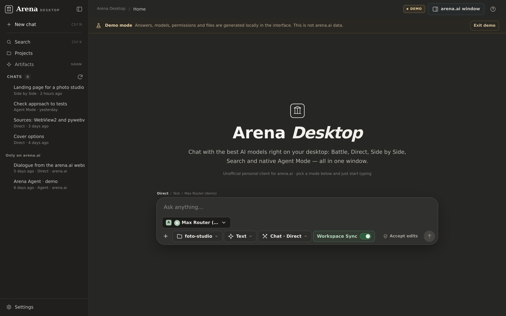
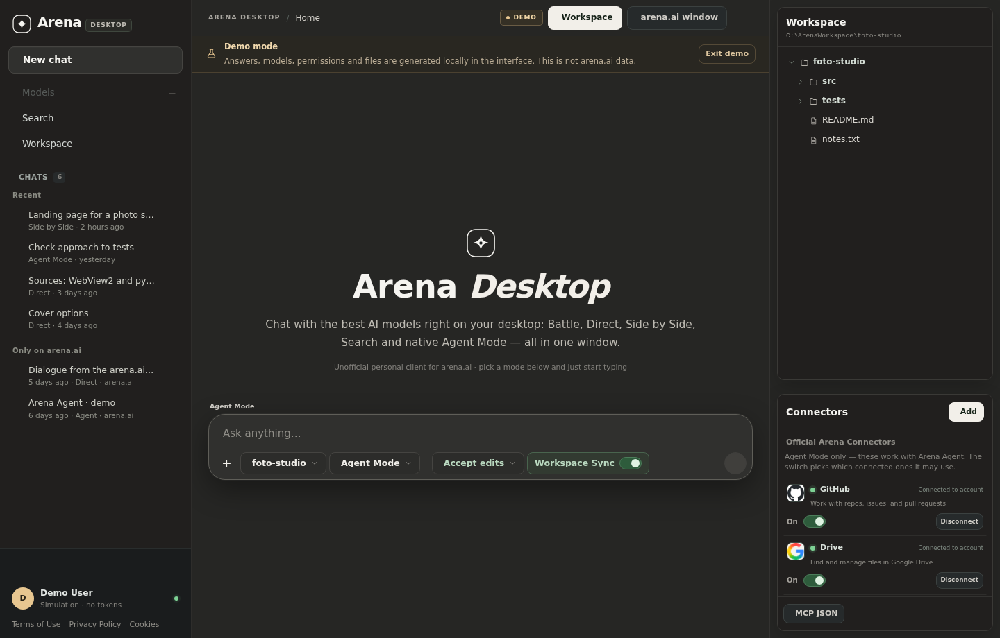

<p align="center">
  
</p>

<h1 align="center">Arena Desktop</h1>

<p align="center">
  <b>An unofficial desktop app for <a href="https://arena.ai">arena.ai</a> — chat, battles, a real Agent Mode,
  and models that can work on the files on your PC, all in one Windows window.</b>
</p>

<div align="center">
  <a href="https://github.com/PlayzAe/arena.ai-desktop/stargazers"></a>
  <a href="https://github.com/PlayzAe/arena.ai-desktop/releases/latest"></a>
  
  
  
  <a href="LICENSE"></a>
</div>

<p align="center">
  
</p>

> [!IMPORTANT]
> Arena Desktop is an **unofficial, community-built client**. It is not affiliated with or endorsed by Arena AI Inc.
> You sign in with your own arena.ai account and are responsible for following arena.ai's terms.
> The app never solves human checks for you — when arena.ai asks for one, you complete it yourself.

---

## Contents

- [Download](#download)
- [What's new in v1.2.0-alpha](#whats-new-in-v120-alpha)
- [What it does](#what-it-does)
- [How it works](#how-it-works)
- [Repository layout](#repository-layout)
- [Run from source](#run-from-source)
- [Tests](#tests)
- [Troubleshooting](#troubleshooting)
- [Help wanted: macOS and Linux](#help-wanted-macos-and-linux)

## What's new in v1.2.0-alpha

**Security hardening release** — a community security audit identified 12 findings across the web layer, CLI and agent engine. This release addresses the high and critical items:

- **API authentication token:** every browser tab now needs a per-launch cryptographic token to call any `/api/*` endpoint. Protects against cross-site request forgery and local network attacks.
- **Sandbox scoping:** file access is locked to the workspace and projects directories only. Home-directory traversal is blocked, and sensitive paths (`.ssh`, `.aws`, `.gnupg`, `.env`, `.git`) are denied by name.
- **Settings allowlist:** only UI-safe keys can be written through the settings API. No more mass assignment of internal config.
- **Inline code blocking:** `python -c`, `node -e`, `powershell -Command`, `cmd /c`, `wsl`, `cscript`, `mshta` and 20+ interpreter/flag combinations are blocked from the agent's shell tool. Covers version-suffixed interpreters like `python3.12`.
- **CLI approval fix:** the permission prompt now shows the actual command and file path, not blank fields.
- **Host validation:** `endswith("arena.ai")` replaced with exact domain + dot-boundary check to prevent spoofing via domains like `evilarena.ai`.
- **Permission mode safety:** `bypassPermissions` is now runtime-only and never persisted to disk.
- **DOM XSS hardening:** the HTML escape function now covers quote characters; inline `onclick` handlers use escaped values.
- **DPAPI encryption:** cookies and account credentials are encrypted at rest using Windows Data Protection API.
- **Security headers:** `X-Content-Type-Options: nosniff`, `X-Frame-Options: DENY`, `Referrer-Policy: no-referrer` on all responses.
- **Terminal endpoint removed:** `/api/terminal` (remote shell) was deleted entirely.
- **Shell safety:** all subprocess calls use `shell=False`.

> [!WARNING]
> This is an **alpha** release. The security fixes have been applied and tested, but the app should be used for evaluation and development only. Report issues on the [issues page](https://github.com/PlayzAe/arena.ai-desktop/issues).

## Download

Every build is on the [releases page](https://github.com/PlayzAe/arena.ai-desktop/releases/latest).

| Platform | Download | Notes |
| --- | --- | --- |
| Windows 10 / 11 | `Arena-Desktop.exe` | Standalone, no installer. Requires Edge WebView2 (built into Windows 11). |

If Windows SmartScreen warns: click **More info → Run anyway** (the EXE is not code-signed).

## What it does

- **Every arena mode in-app**: Battle, Side by Side, Direct, Agent Mode — no browser tab needed.
- **Every modality**: Text, Image, Web Search, Code, Video, Auto (same rules as the website).
- **Workspace Sync**: models can list, read, write, edit files and run commands in a folder you choose, under a permission mode you control.
- **MCP servers + Arena connectors**: local MCP servers (presets, JSON, CLI) and official Arena connectors with per-connector toggles.
- **Multi-account**: switch arena.ai accounts in one click, parallel chats, local + cloud history.
- **Agent Gateway**: the genuine Arena Agent can use your local MCP servers and workspace folder through a pairing-protected tunnel.
- **Sub-agents, plan approval, memory, automations, compact context, undo** — see [RELEASE_NOTES.md](RELEASE_NOTES.md) for the full changelog.

<p align="center">
  
</p>

## How it works

```
┌──────────────── Arena Desktop (pywebview / WebView2) ────────────────┐
│  Single-page UI  ──►  local Flask API + SSE streaming  (arena/web/)  │
│                              │                                       │
│        ┌─────────────────────┼──────────────────────┐                │
│        ▼                     ▼                      ▼                │
│  arena.ai engine      native Arena Agent     local tool loop         │
│  (hidden window,      (agentic API,          (arena/agent.py +       │
│   real account)        resumable)             MCP connectors)        │
└──────────────────────────────────────────────────────────────────────┘
```

| Module | Role |
| --- | --- |
| `arena/desktop.py` | Native window shell (pywebview + WebView2) |
| `arena/web/app.py` | Flask API, SSE streaming, chat orchestration, accounts |
| `arena/web/static/` | The whole UI (HTML/CSS/JS, no build step) |
| `arena/engine.py` | Hidden arena.ai window for signed-in requests |
| `arena/native_agent.py` | Native Arena Agent protocol |
| `arena/agent.py` | Local tool loop: parsing, execution, permissions |
| `arena/connectors.py` | Local MCP server manager |
| `arena/permissions.py` | Permission modes and per-chat approval broker |

## Repository layout

```
Arena-Desktop/
├── arena/                  # application package
│   ├── web/                # Flask backend + static UI
│   └── tools/  ui/         # CLI-era tools and terminal UI
├── assets/                 # icon and logos
├── docs/                   # screenshots
├── scripts/                # build verification
├── tests/                  # pytest suites (unit/API + browser UI)
├── arena-cli.spec          # PyInstaller spec → Arena-Desktop.exe
├── requirements.txt
├── START_ARENA_DESKTOP.bat # one-click source launcher
├── KNOWN_ISSUES.md
├── RELEASE_NOTES.md
└── SECURITY_AUDIT.md
```

## Run from source

1. Install **Python 3.11+** and the Edge WebView2 Runtime.
2. Double-click **`START_ARENA_DESKTOP.bat`** — creates `.venv`, installs deps, opens the app.

Or manually:

```powershell
py -3 -m venv .venv
.\.venv\Scripts\python.exe -m pip install -r requirements.txt
.\.venv\Scripts\python.exe -m arena.desktop
```

## Tests

```powershell
.\.venv\Scripts\python.exe -m pytest tests --ignore=tests/test_ui_browser.py   # unit/API
$env:RUN_BROWSER_TESTS=1; .\.venv\Scripts\python.exe -m pytest tests/test_ui_browser.py  # UI (demo mode)
```

## Troubleshooting

- **SmartScreen warning**: click More info → Run anyway.
- **429 rate limit**: arena.ai's daily/per-modality cap, not the app. The app shows which limit and when it resets.
- **Human check popup**: complete it manually in the Arena window.
- **Logs**: `%USERPROFILE%\.arena-personal\desktop.log`

## Help wanted: macOS and Linux

Arena Desktop is Windows-only (WebView2). A macOS/Linux port would need a different shell (e.g. webview bindings for GTK/Cocoa). PRs welcome.

## Limitations

- **Windows only** — WebView2 dependency.
- **Arena's limits apply** — daily caps, rate limits, new-account video gate. The app explains them; it can't lift them.
- **Human checks stay manual** by design.
- **Code mode uses arena's sandbox**, not your PC. See [KNOWN_ISSUES.md](KNOWN_ISSUES.md).
- **Not code-signed** — SmartScreen may warn on first run.

## Credits & license

Built by [PlayzAe](https://github.com/PlayzAe) and contributors. Major contributions from
[Maxusimlive](https://github.com/Maxusimlive) on the desktop UI, chat system, workspace features
and native Arena Agent integration.

Released under the [MIT License](LICENSE). Not affiliated with Arena AI Inc.

## Contact

[](https://discord.com)

DMs open — `@playzae`. For bugs and features: [GitHub Issues](../../issues).
