# The 1.5.2 rework

What has changed in this fork so far, what the sidebar becomes, and what is
still to come. Written to be read in a year, so it names the files it talks
about.

Arena Desktop started as a copy of the community client and is being rebuilt
into a distribution of its own: a normal Windows installer, updates that
install themselves, and an interface with a hand-made feel instead of the
generic assistant look. **The bar is the Claude desktop app, not a template
copied from it.**

---

## 1. Installer

`Arena-Desktop-Setup-<version>.exe` is the same binary as the portable build,
and its own file name is the switch: double-click it and one 540x372 window
appears — the brand, one sentence, one hairline progress bar. It asks nothing.

- **Per-user.** Installs to `%LOCALAPPDATA%\Programs\Arena Desktop`, no
  administrator prompt.
- **Registered like a normal app.** Start-menu shortcut, an entry under *Apps &
  features*, a working uninstaller at `UNINSTALLER\HKCU`.
- **Writes `install.json`** (`version`, `previous`, `app`) next to the exe, so
  the app knows what it is and where it came from.
- **Never touches user data.** `%USERPROFILE%\.arena-personal` is left exactly
  where it was: accounts, chats, settings, memory, MCP config. `portable.txt`
  and `ARENA_CONFIG_DIR` are still honoured.

Code: `arena/setup/core.py` (install, uninstall, shortcuts, registry),
`arena/setup/ui.py` (the pywebview window), `arena/setup/web/index.html` (the
page inside it, which also renders the update and uninstall states),
`arena-cli.py --setup | --uninstall | --apply-update`.

### The download that did not install (fixed in 1.5.3)

1.5.2 published both names, but only `--setup` opened the installer and a
double-click passes no arguments at all. So the file called *Setup* simply
started the app: nothing in `%LOCALAPPDATA%\Programs`, no Start-menu shortcut,
no entry in *Apps & features*, no uninstaller — Windows search found a stray
exe instead of an app. The release notes promised an installer that the code
never entered.

The name now decides. `arena/setup/core.py` gained `looks_like_installer()`
(frozen builds only, `setup` or `installer` in the file's own stem) and
`setup_mode_from_argv()`, and `arena-cli.py` asks the second one before it
opens anything:

| started as | what happens |
|---|---|
| `Arena-Desktop-Setup-1.5.3.exe`, double-clicked | installs, then offers to open the app |
| `Arena-Desktop-1.5.3.exe`, double-clicked | the app, nothing installed |
| `Arena-Desktop.exe` in the install folder | the app, `install.json` already there |
| any file with `--app` | the app, even from a file called Setup |
| any file with `--setup` | the installer, even from source |
| `python arena-cli.py` | the app — a source run never installs |

The window is cream paper (`#f4f1ea`), ink (`#14161a`), one green accent
(`#1e9e63`), and a serif wordmark. It is deliberately not a wizard and
deliberately not the app's dark theme.

## 2. Updates that install themselves

- The app checks the release feed at startup and every 6 hours, per channel
  (stable / beta), cached for 6 hours per channel.
- When something newer exists, a single dialog says so: *Version 1.5.3 is
  available*, what you have against what is offered, the release notes, the
  date and the size, then *Later* or *Download and install*.
- The download is verified against the published size and, when GitHub provides
  it, the SHA-256 digest. It is then run in place of the app; the app closes,
  the setup installs over it and the app comes back. **Nothing is
  reconfigured.**
- Running from source, or on anything that is not Windows, the same dialog
  offers the release page instead of pretending it can self-replace.

Code: `arena/updater.py` (feed, download, verify, apply),
`arena/web/server/updates.py` (the HTTP routes), `arena/web/static/js/15-update.js`
(dialog and island).

**The feed points at this fork** — `Arvex-GH/ArenaAI-Desktop-Major-Rework` — not
at the upstream project, so a build of this rework never installs the upstream
binary over itself. `ARENA_UPDATE_REPO` and `update_repo` in config still
override it.

## 3. The right column is gone (for now)

The Workspace/Connectors panel was removed rather than restyled.
`WORKSPACE_PANEL_ENABLED = false` in `js/01-core.js` gates it, the grid's third
column collapses, and the `.app` layout no longer reserves space for it.
Folder choice still works from the composer chip and Settings → Folder.

## 4. Upstream v1.5.1 merged in

The maintainer's reliability release shipped a different backend shape:

- `arena/web/app.py` (8.4k lines) is now a 40-line loader that runs the parts
  in `arena/web/server/` inside one shared namespace.
- The arena.ai page script moved to `arena/engine_js.py`.
- The frontend was reworked (status banner, run-on-this-PC, account menu,
  named errors).

What that meant here:

- Our update routes moved into their own part,
  `arena/web/server/updates.py`, registered in `PARTS`. The old
  `/api/update-check` in `chats.py` was deleted, so the feed is defined once.
- **Version has one source.** `arena/version.py` is read by `core.py`,
  `arena/__init__.py`, the installer and CI; nobody hardcodes it any more.
- `arena-cli.spec` collects `arena/web/server/` by folder
  (`collect_submodules`), because the parts are loaded by name. Without that,
  the next new part silently produces an exe that dies on launch.
- The fork's history was squashed on import and shared no ancestry with
  upstream, so it was re-parented onto `723c4ba` before merging. Future syncs
  are now a plain `git fetch upstream main && git merge upstream/main`.

## 5. How this is checked

- `tests/` — 398 tests, including installer, updater and route coverage.
- `.github/workflows/build.yml` — runs the suite **before** PyInstaller, builds
  the exe, runs `Arena-Desktop.exe --version` as a smoke test, and only
  publishes a release on a `v*` tag that matches `arena/version.py`.
- `docs/screenshots/preview/` — the seven frames of the interface as it stood
  before this rework, including the three states of the setup window.

---

## The sidebar

### What was rejected

The version shipped before this rework had a **big New chat button** filling a
whole row, and under it two loose rows — *Models* with a count, *Search* — that
read as buttons with no structure. Against the Claude app the difference is not
colour, it is hierarchy: there, the rail is a list of quiet rows where the
current chat is the only thing that looks selected.

### What it becomes

A calm rail, 252px wide, in the app's own voice. Captured from this build:

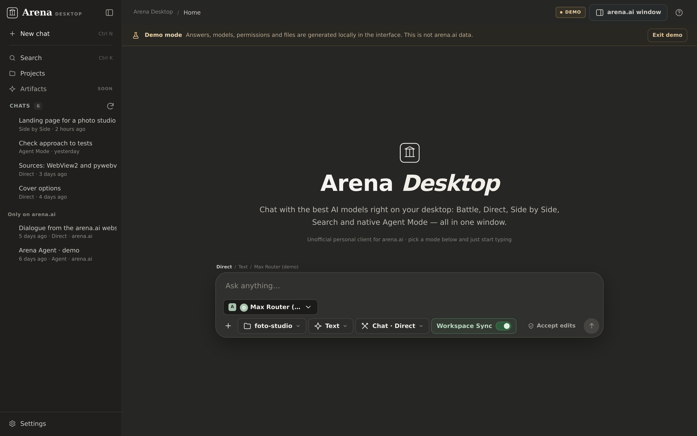

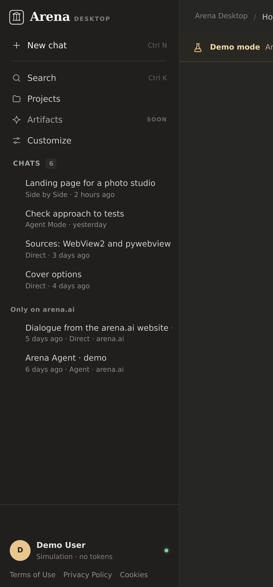

```
 ⛬ Arena  DESKTOP                      ⌄
 ─────────────────────────────────────
 +  New chat
 ─────────────────────────────────────
 ⌕  Search                    Ctrl+K
 ▤  Projects
 ◈  Artifacts
 ─────────────────────────────────────
 CHATS                             ⟳
   Landing page for a photo studio
   Check approach to tests
   ...
 ─────────────────────────────────────
 ⚙  Settings
```

- **New chat is a row**, same height as its neighbours, plus glyph and label. It
  is the first thing in the list, not a call to action filling the rail.
- **Four rows, then a floor.** New, Search, Projects, Artifacts in the rail's
  own body — so the shape matches the reference without pretending the app has
  features it does not — and one plain *Settings* row at the very bottom, cut
  off by a hairline:
  - *Search* opens the chat filter that already existed.
  - *Projects* opens the folder chooser (`data-action="workspace"`).
  - *Artifacts* is wired but has nothing to show until the workspace panel
    returns; it says so instead of doing nothing quietly.
  - *Settings* at the bottom opens the settings dialog. There is no *Customize*
    row any more, no avatar block, and no row of three footer icons: the
    account, permissions, folder, memory, gateways, components and the legal
    documents all live behind that one row.

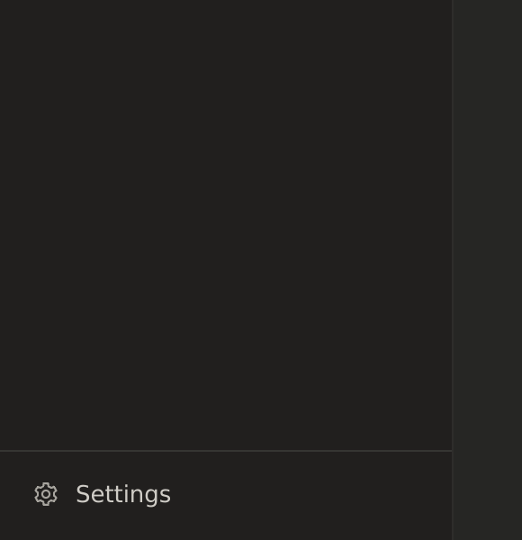

The account came back with it. It had been cut out of the rail while this
rework was in progress; now it is the first thing the settings dialog shows —
avatar, name, sign-in state, *Log out* and *Open arena.ai window* — instead of a
block in the sidebar that grew a menu of its own. The document links moved from
the rail's floor into **Settings → About**, next to *GitHub*, so the legal text
is not the last thing the eye lands on when it looks for settings.
- **The Models row is gone.** Choosing a model belongs to the composer, where
  you already pick a model per message. (The count that lived in the rail is
  now only in the composer's picker.)
- **Hierarchy by typography, not boxes.** The section label is a 10px
  letterspaced micro-caps line; chat titles are the only 13px text; metadata
  drops to 10px and only appears on the row you are pointing at.
- **Hairlines instead of borders and shadows.** One 1px rule between the rail
  and the thread, one above the Settings row, nothing else.
- **The wordmark is a serif**, the same voice as the setup window, so the app
  and its installer read as one product. The "Desktop" tag lost its pill.
- **The rail header is 52px**, matching the topbar, so the two share one
  horizontal line across the window.
- **The collapse control works.** It had been drawing nothing: icon spans that
  were written straight into `index.html` (no `.icon` class) had no box, so the
  panel glyph collapsed to zero width — the same reason the footer icon buttons
  of that build looked empty. One `:where([data-icon])` rule gives every icon
  span a box without touching component rules, and the control now flips
  between `panel-left` and `panel-right` as the rail opens and closes.
- **Collapsed, the same rows keep their icons.** Nothing is re-invented for the
  76px state:

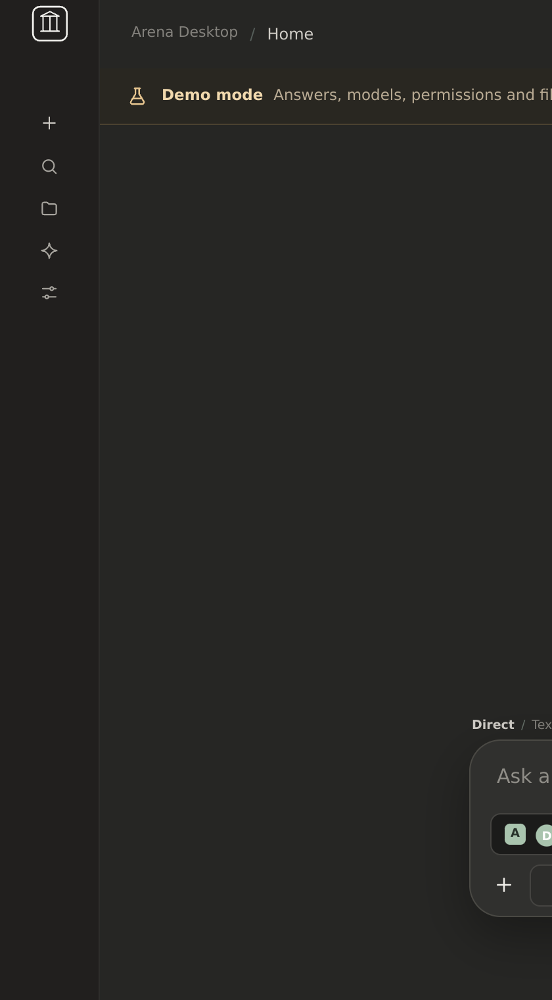

### Both themes

The rail is built on tokens so it has a **paper-light** counterpart — warm off
white, ink text, hairlines at 8% — alongside the current dark. The choice lives
in **Settings → Appearance** and is stored in config, so it survives updates.

Light is the default for a new install: it matches the installer, which already
speaks that language. Dark is the same rail with the ink inverted, not a second
design.

This is the first slice of the theme work. The rest of the app still uses the
dark palette, so the switch is not offered in the UI until the thread, composer
and dialogs follow in the next step.

---

## Modes: Chat and Agent

The four modes used to sit in one flat list, as if Battle and Agent were the same
kind of choice. They are not. The mode picker now has two sections:

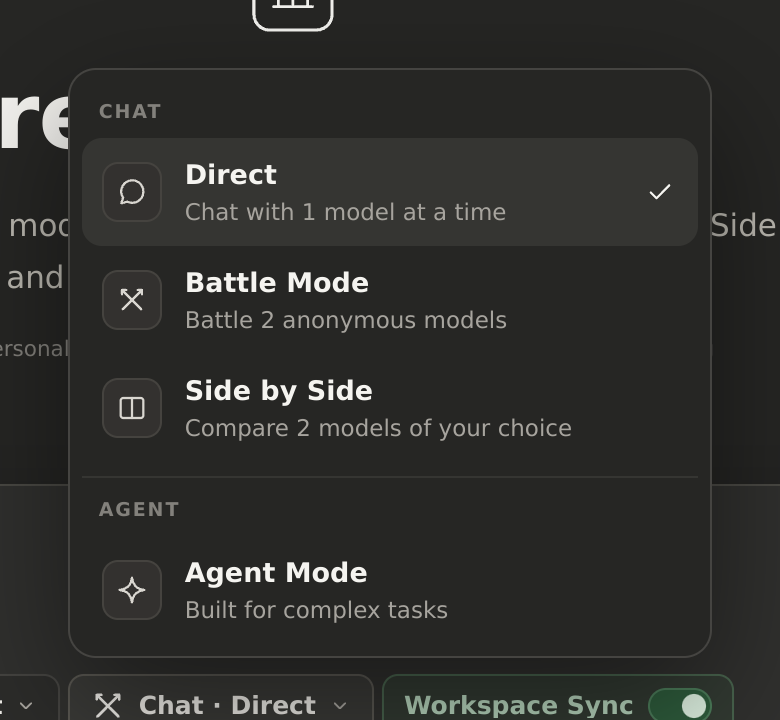

- **Chat** — Direct, Battle Mode, Side by Side. Talking to models, with a work
  type (text, image, video, search, code) on top.
- **Agent** — the mode that works in thinking steps and runs tools itself.

The composer chip says where you are: `Chat · Direct`, `Chat · Battle`,
`Agent`. One label, two levels.

### What is intended, and not built yet

- **Files in Chat mode.** Chat should be allowed to read and edit the chosen
  folder too, with the difference being behaviour rather than permission: Chat
  answers and edits when asked, Agent plans in steps and works through them.
  Today the local file tools are reachable only from Agent Mode, so this is a
  backend change to the tool loop, not a switch: it ships when the loop is
  safe to run outside Agent Mode.
- **Arena's account connectors in Agent Mode.** The connectors a user has linked
  on arena.ai should be available to the agent, fetched from the account rather
  than configured in the app. This waits for the better implementation that is
  planned, so nothing is half-wired here.

## The composer: confirmation next to send

Bypass used to paint a red alert bar across the composer, which read as "the app
is broken" for a setting one click away. It is now a red dot beside the send
button, and the confirmation selector lives there too instead of being lost
between the folder and work-type chips.

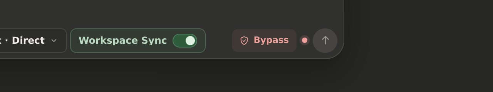

- `Ask` · `Accept edits` · `Auto` · `Plan only` · `Bypass` — unchanged
  behaviour, new home.
- In bypass the chip turns red and a 7px dot sits between it and send. Nothing
  else on screen changes.

## The conversation: one line per call

A tool call is part of the model's reply, not a card dropped into the
conversation. It is one silver line — `Bash npm run build` — in mono, sitting at
the exact place in the answer where the model made it, with the outcome at the
end of the line (`done`, `exit 0`, `exit 1`, `running`). No box, no fill, no
shadow, no radius, and no parentheses: the tool name and what it acted on are
two weights of the same line, not a function call.

The rows are no longer collected above the answer. Each one records where in the
reply it happened, and the renderer splits the text at those points, so a
sentence, its command, and the sentence after it read in order:

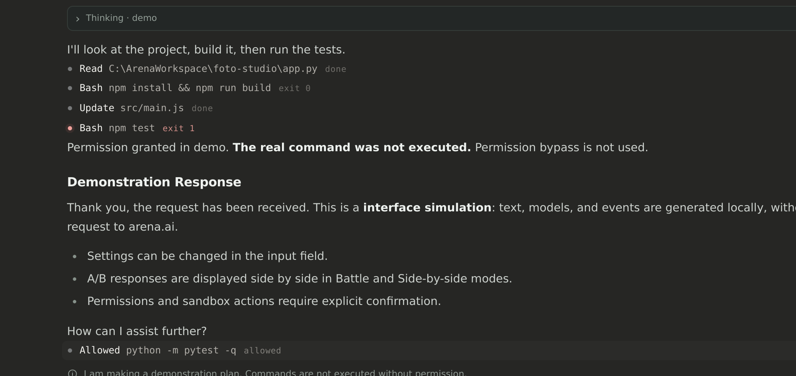

**Nothing is open by default.** A finished call is one line. While a command
runs, that one row opens by itself and streams its newest output under a
hairline; the moment it ends the detail folds away again — a 420 ms collapse,
not a snap — leaving the single line and its exit code:

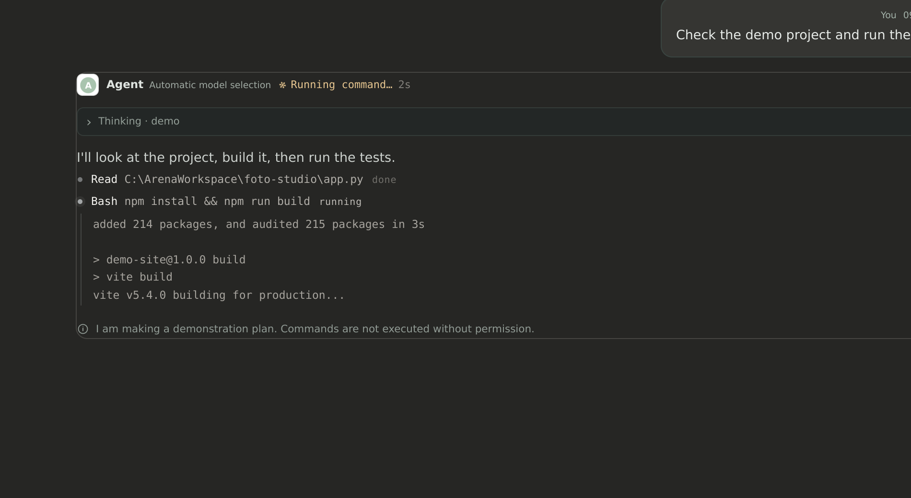

Clicking a finished row opens it again for inspection. Clicking any row closes
it — including one that is still running, which stays closed until it ends.
A row is a label you can open, never a panel you cannot.

### Approval is a pop-up

A confirmation is transient, so it does not live in the thread. The window dims
and a small sheet asks one question: the command, the folder, a line about what
it will do, and *Allow once* / *Allow for this session* / *Deny*. `Escape`
denies. The sheet is anchored above the composer, so the eye does not have to
travel to the middle of a long conversation to answer it:

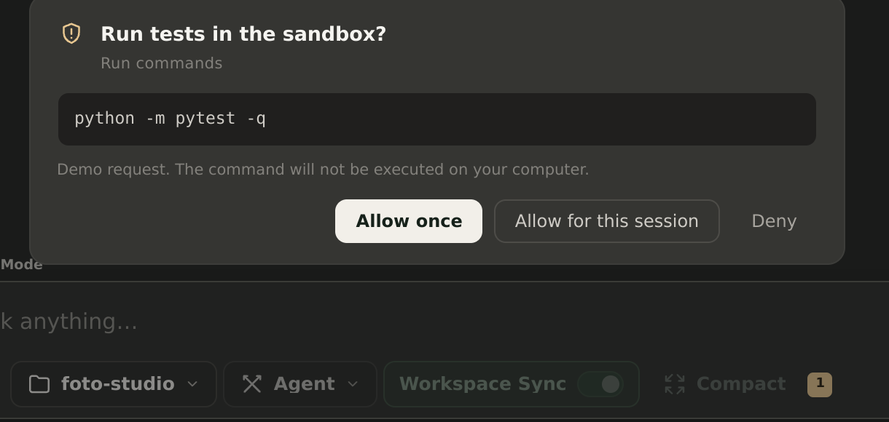

The thread keeps only the receipt — the same silver line, `Allowed python -m
pytest -q  allowed` — because that is a fact about the conversation, while the
question was a moment. The two toasts that used to fire around approvals (one
when it arrived, one when it was answered) are gone: the pop-up is the
notification, the receipt is the record.

### A chat is named after the prompt

The title is the user's first message, trimmed to 52 characters, set the moment
it is sent rather than after the reply. It is stored against the chat id in
`arenaPersonal.chatTitles.v1`, so a refresh from arena.ai — which still calls
the chat "New chat" — cannot rename it underneath you. Chat rows carry
`data-chat-id`, so the mapping is easy to check from the console.

### The model announces a call before writing it

The reply used to carry the raw block: a `<tool name="write_file">` with a whole
file body inside it streamed into the chat, and the app only tidied it away once
the backend had executed the call and posted a row. For a second or two the
conversation showed the file.

Now every call is announced first. The guide asks the model for a marker line
before the call and a bare `~~~` after it:

```
~~~write
<tool name="write_file"><path>src/hero.js</path><content>
…the whole file…
</content></tool>
~~~
```

The marker carries the kind, and the kind is what the chat shows while the block
streams — one silver line, breathing, with the argument appearing as soon as it
arrives:

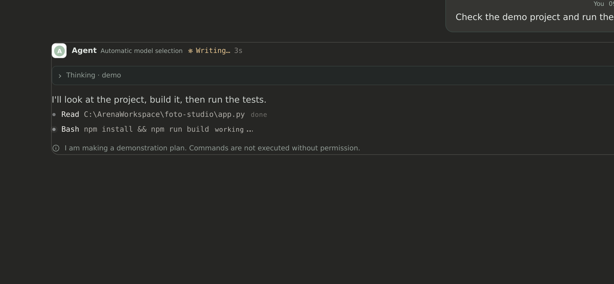

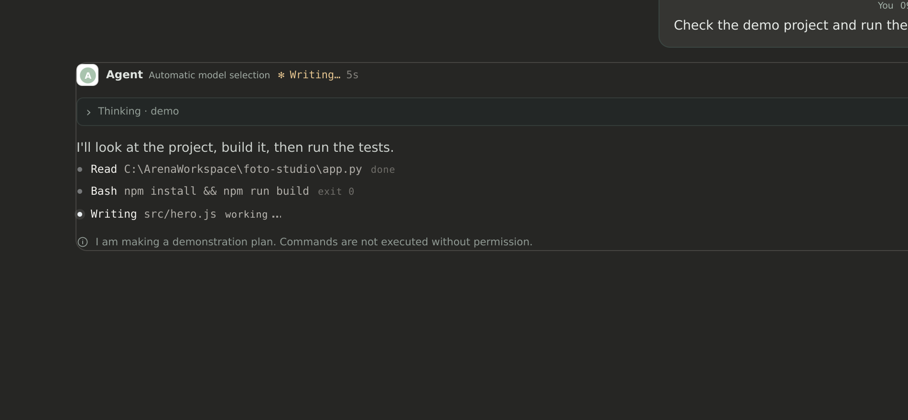

Nothing of the block underneath reaches the chat: not the tag, not the path
attribute, not one line of the file. When the closing `~~~` arrives the pending
line is removed and the real row appears once the backend has run the call, with
its exit code and its fold-away detail.

The vocabulary, one marker each: `~~~command` (run_cmd, stop_cmd), `~~~write`,
`~~~edit`, `~~~read`, `~~~search`, `~~~list`, `~~~delete`, `~~~plan`, `~~~todos`,
`~~~ask`, and `~~~tool` for connector tools.

Two rules keep it safe:

- **A closing `~~~` only counts after the call's own tag has closed.** A file
  being written may legitimately contain a `~~~` fence (Markdown), so the
  envelope cannot end inside the content.
- **Markers are display only.** The backend strips them from stored history and
  from the visible answer, and never lets one reach a tool parameter — the tag
  inside runs exactly as it did before.

If a reply stops mid-call, the pending line stays and reads `stopped` instead of
`working`, so the interruption is visible rather than silent.

## The 1.5.2 release

The rework is not finished, so the first published build is **1.5.2** rather
than the 1.6.0 the tree had been carrying for work that never shipped. Nothing
was downgraded: no `v*` tag had ever been pushed, so 1.5.2 is the first release
the in-app updater can see, and every install that follows is an update.

A tag is the whole release. `git push origin v1.5.2` starts `build.yml`, and the
workflow refuses to publish unless the tag matches `arena/version.py`:

| step | result for 1.5.2 |
|---|---|
| tag | `v1.5.2` on `62918cc`, the merge commit of the release PR |
| tag vs `arena/version.py` | `1.5.2` = `1.5.2` |
| test suite (before PyInstaller) | passed — the same 391 tests as on the branch |
| build | 27.3 MB single exe; `Arena-Desktop.exe --version` answered `Arena Desktop 1.5.2` |
| assets | `Arena-Desktop-Setup-1.5.2.exe` and `Arena-Desktop-1.5.2.exe`, 28,614,141 bytes each |
| digests | both `sha256:e4fbb460c15b4d75d693f36d4849e97bb9308d2a66d699f0739158b3a6ceccad` — one binary under two names, as designed |
| release | <https://github.com/Arvex-GH/ArenaAI-Desktop-Major-Rework/releases/tag/v1.5.2>, published, not a draft, not a pre-release |

The feed was then read the way the app reads it — `updater.fetch_latest()` over
the public API, no token — from a build that calls itself 1.5.2:

```
this build: 1.5.2
feed version: 1.5.2 | title: Arena Desktop 1.5.2 | prerelease: False
picked asset: Arena-Desktop-Setup-1.5.2.exe 28614141 installer
digest: sha256:e4fbb460c15b4d75d693f36d4849e97bb9308d2a66d699f0739158b3a6ceccad
url allowed: True
1.5.1 sees update: True | 1.5.2 sees update: False
```

Two things worth keeping: the feed hands back the **Setup** asset rather than the
portable one (both are `.exe`, the installer wins), and a 1.5.2 build does *not*
see an update to itself, so nobody is offered the version they are running.
`/releases/latest` never returns a pre-release, which is why the tag was
published as a normal release even though the app is unfinished — the "not done"
part lives in this document and in the release notes, not in a flag that would
hide the update from everyone.

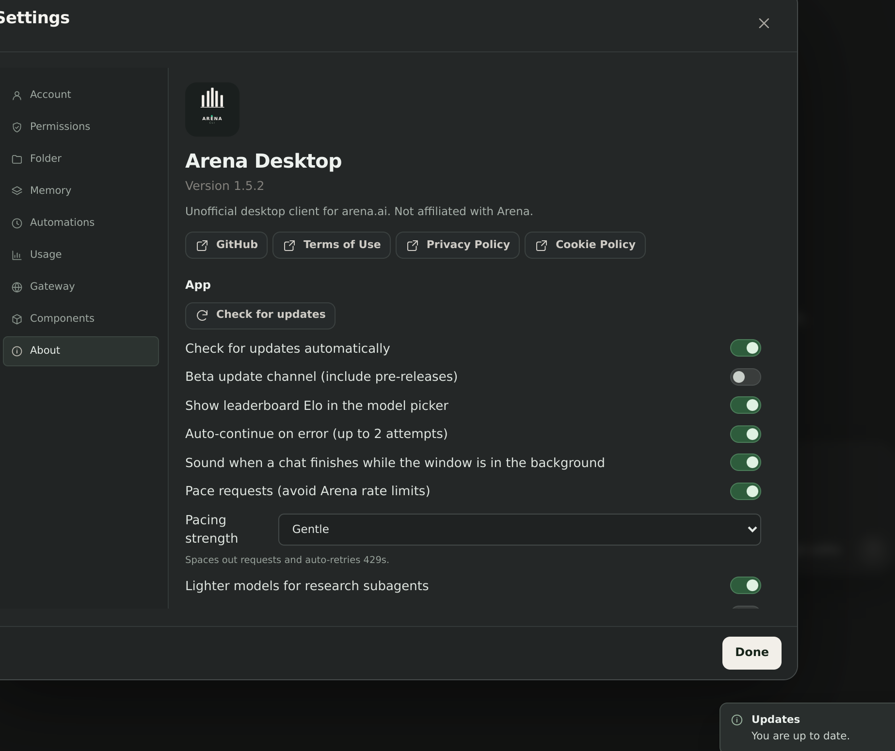


One limit of the machine that cut the release: its egress blocks
`release-assets.githubusercontent.com`, so the built exe could not be downloaded
back and re-hashed there. Integrity rests on GitHub's own digest, computed
server-side on upload — and on the two assets carrying the same digest, which
proves the installer and the portable build are the same bytes. The download and
verify path itself is covered by `tests/test_installer.py`.

### 1.5.3, the day after

Two reports against 1.5.2, both fixed the same day — the installer never ran,
and an internal error explained nothing. The tag is the same ritual:

| step | result for 1.5.3 |
|---|---|
| tag | `v1.5.3` on `752fdec`, the merge commit of the fix PR |
| tag vs `arena/version.py` | `1.5.3` = `1.5.3` |
| test suite (before PyInstaller) | passed — 398 tests |
| assets | `Arena-Desktop-Setup-1.5.3.exe` and `Arena-Desktop-1.5.3.exe`, 28,617,973 bytes each |
| digests | both `sha256:ddd58f13b299ba833906ccb02c04cae93b2634d7353e619655d9b63743fc32b3` |
| release | <https://github.com/Arvex-GH/ArenaAI-Desktop-Major-Rework/releases/tag/v1.5.3> |

And read back the way the app reads it:

```
feed version: 1.5.3 | title: Arena Desktop 1.5.3 | prerelease: False
picked asset: Arena-Desktop-Setup-1.5.3.exe 28617973 installer
digest: sha256:ddd58f13b299ba833906ccb02c04cae93b2634d7353e619655d9b63743fc32b3
1.5.2 sees update: True | 1.5.3 sees update: False
```

Worth noting for anyone on the broken 1.5.2: its updater already worked, because
it runs the downloaded file with `--setup --update --silent` — an explicit flag
that never depended on the file's name. So 1.5.2 installs itself properly when
it takes 1.5.3, and only the double-click path had to be fixed.

## When a reply fails

A crash anywhere inside a reply used to arrive as one sentence — *The app hit an
internal error.* — with nothing else: no exception name in the window, and no
traceback in `desktop.log`, because the stream wrapper caught the exception and
logged nothing. A report like that could not be acted on, by the person who saw
it or by anyone they told.

Three things changed:

- **The log gets the traceback.** `_sse_wrap` in `arena/web/server/stream.py`
  calls `LOG.exception` before it emits the error event, so
  `%USERPROFILE%\.arena-personal\desktop.log` carries the stack.
- **The row carries the exception.** The `detail` field the backend always sent
  (and the window always dropped) is kept on the turn and rendered under the
  message in mono, with *Copy details* beside it. The toast stays one line.
- **Two silent crashers closed.** The arena.ai window is driven over pywebview,
  the least dependable part of the app; `ENGINE.wait_ready` and
  `ENGINE.native_preflight` were called unguarded at the start of an Agent turn,
  where a closed or crashed WebView2 surface ended the whole reply before a
  single character. `_engine_ready()` and `_engine_cx()` in
  `arena/web/server/arena_agent.py` turn that into "not ready yet" and a request
  without a `cx` blob — the same request the app sent before the preflight
  existed.

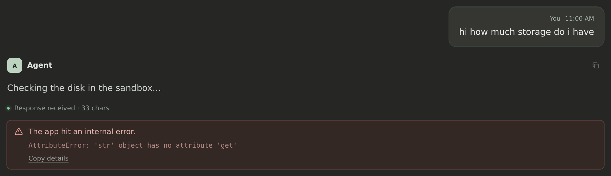

`tests/test_crash_reporting.py` pins all of it: the friendly message, the
exception beside it, the traceback in the log, and a dead engine reading as "not
ready" instead of an internal error.

## The 1.5.4 release

Two bugs, both of them found by using the shipped build on a real PC rather
than by reading it, and neither of them visible in a screenshot: 1.5.4 changes
no pixels. The installer window and the chat look exactly as they did in 1.5.3 —
what changed is that they now do their job.

### The installer that showed "Starting…" and stopped there

1.5.3's double-clicked Setup file opened its window, set the status line to
*Starting*, and then never moved again. About a minute later Windows greyed the
window out and called the program *not responding*. The install had not begun:
`%LOCALAPPDATA%\Programs\Arena Desktop` was never created, and `--setup
--silent` on the same file installed the app in **four seconds**. So the core
was fine and the window was the problem.

The window is a pywebview surface over the installer core, and pywebview builds
a page's JavaScript bridge by walking **every public attribute** of the object
passed as `js_api` — recursively, because it is building the page's callable
surface. `SetupApi` kept its window in a public attribute:

```python
self.window = None      # 1.5.3
...
api.window = window     # after create_window
```

The walk therefore left the bridge, entered the pywebview `Window`, the WinForms
form and the WebView2 objects behind it, and made cross-thread calls into them
from the injection thread. The message pump needs the GIL back to paint and to
answer input; the walk held it while it waited on the window. Deadlock, faded
title bar, frozen first frame — everything that was reported.

The app itself never had this bug, and its bridge says why in one line:
`arena/desktop.py`'s `JsBridge` keeps `self._window` and documents that
*pywebview exposes every public attribute to JS and walks it recursively, so the
window reference must stay private*. The installer was the one place that forgot.

1.5.4 keeps it private, and adds two nets under it:

- **A watchdog.** If the page has not called the bridge twelve seconds after the
  window is created, `_bridge_watchdog` starts the same install from Python and
  closes the window itself. `SetupApi.start()` is idempotent, so a bridge that
  turns up late can never install twice.
- **A log.** A windowed exe has no console, which is why the 1.5.3 hang left no
  trace anywhere. Setup now writes `%USERPROFILE%\.arena-personal\setup.log`
  and records the window it created and the install it ran.

`tests/test_v154_fixes.py` pins the surface itself: every public, non-callable
attribute of `SetupApi` must be a plain value, which is exactly the rule the
walk depends on.

### What shipped, and what the window is not

`v1.5.4` is published with both files at 28,621,059 bytes
(`sha256:437d85aa…eb517`), and the feed check behind the in-app updater sees it:
1.5.3 is offered the update, 1.5.4 is not offered one to itself.

Two honest notes about the window. The in-app updater has always run the
downloaded file as `--setup --update --silent`, so nobody who updated from
Settings ever saw the setup window at all — the freeze only ever hit the
double-click path, which is the path that had to be proven fixed. And install
mode over a copy that is *running* still fails on the locked application file
and reports an access error in the window; update mode already handles it by
waiting for the app to exit, and install mode should learn the same trick.

### Bypass permissions, and the missing fifth mode

With *Bypass permissions* selected, every message died before the model was
called:

```
The app hit an internal error.
KeyError: 'bypassPermissions'
```

`arena/agent.py`'s `MODE_NOTES` — the paragraph in the prompt that tells the
model how the current permission mode behaves — carried four of the five modes:

```python
MODE_NOTES = {"plan": …, "default": …, "acceptEdits": …, "auto": …}
```

and `arena/web/server/local_agent.py` built the session guide with
`agent.MODE_NOTES[mode]`. Any turn in the fifth mode raised. The mode whose whole
point is "run everything without asking" was the one that asked for nothing and
returned a traceback.

The mode has its note now, `agent.mode_note(mode)` falls back to the default
text instead of raising so a mode added later can never take a turn down with
it, and the call site reads `permissions.MODES.get(mode, mode)` as the matching
guard. `tests/test_v154_fixes.py` asserts that every key of
`permissions.MODES` has a note and that the guide builds for each of them.

## Still to come

- **Session list presentation.** Grouping (today / this week / older), the way a
  chat row shows mode and age, and the behaviour of the list while a chat is
  open. Deferred on purpose: the rail had to be right first.
- **Chat mode gets the file tools**, with Agent Mode keeping the step-by-step
  loop and gaining arena.ai's account connectors.
- **The return of the right bar** — workspace files and connectors — and with
  it the real *Artifacts* view.
- **The light theme across the app**, not just the rail, with the Settings
  switch.
- **The next release.** `v1.5.2` is published and the update loop is live; the
  next tag carries whatever lands here first, and the version has to be bumped
  in `arena/version.py` before the tag or the workflow refuses to build.

The rest is coming. This document will grow with each step rather than being
rewritten.
