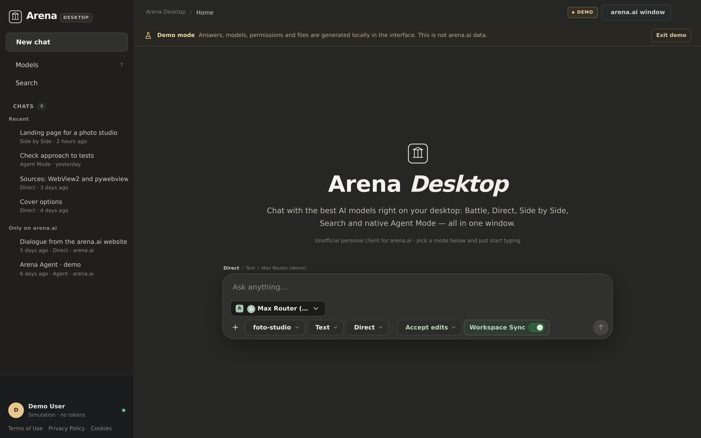
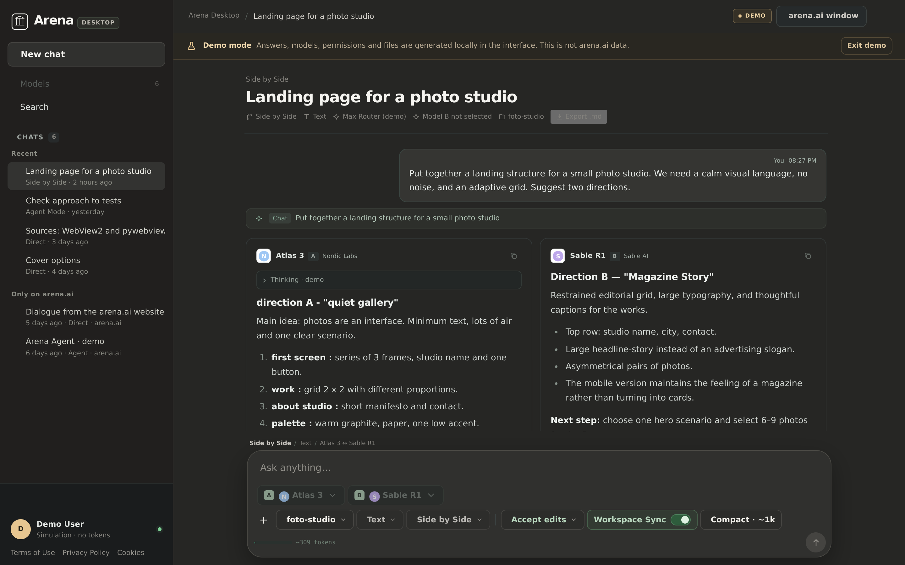
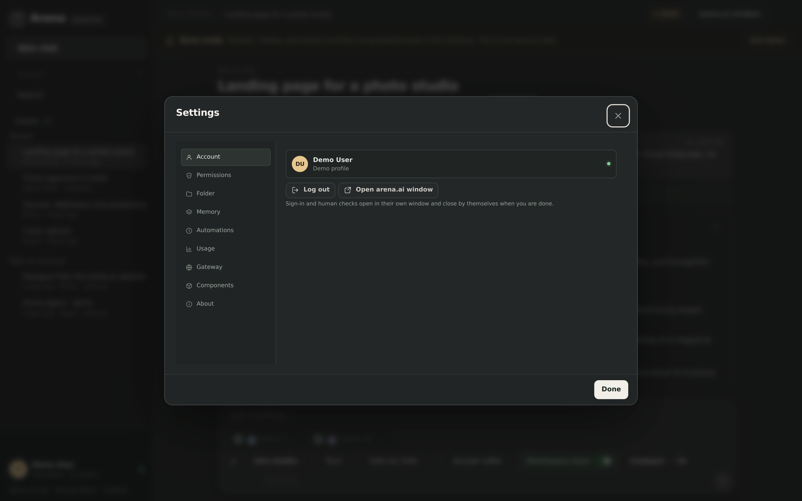
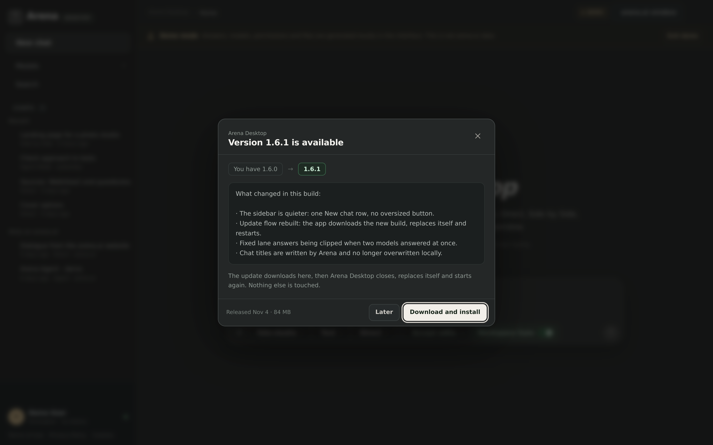
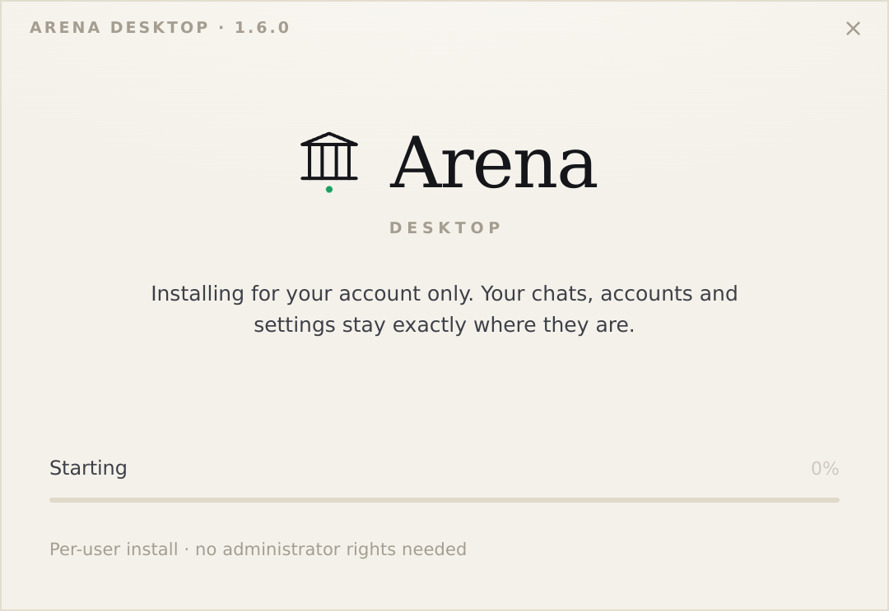
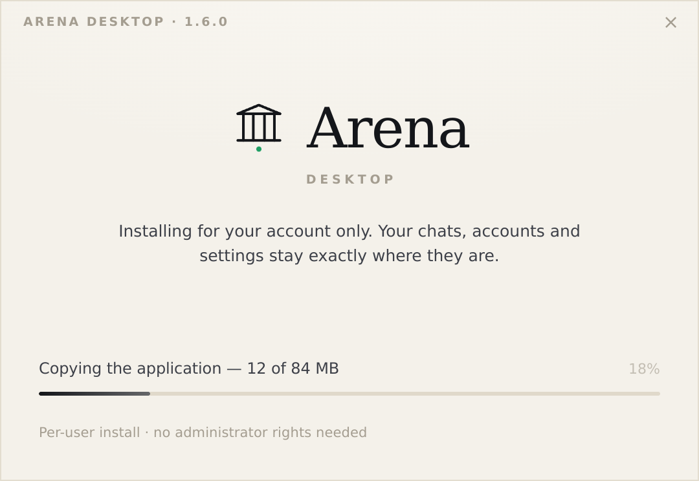
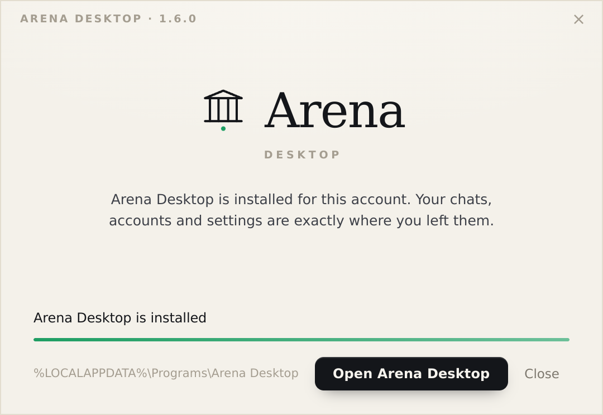

# Arena Desktop 1.6.0 — interface preview

Screenshots of the released **1.6.0** build, captured from demo mode at 1440×900 @2x
(the setup window frames are 540×372 @2x, the real window size).

These were taken **before** the sidebar rework, so they double as the "before" record:
the oversized *New chat* block and the flat *Models* / *Search* rows visible on the
left are exactly what step 3 replaces.

## Home

## Chat — Side by Side

## Settings

## Update dialog

## Setup window

| First screen | Copying files | Installed |
|---|---|---|
|  |  |  |

The window is per-user, takes no answers, and leaves `%USERPROFILE%\.arena-personal`
untouched — the three frames above are the whole flow.
