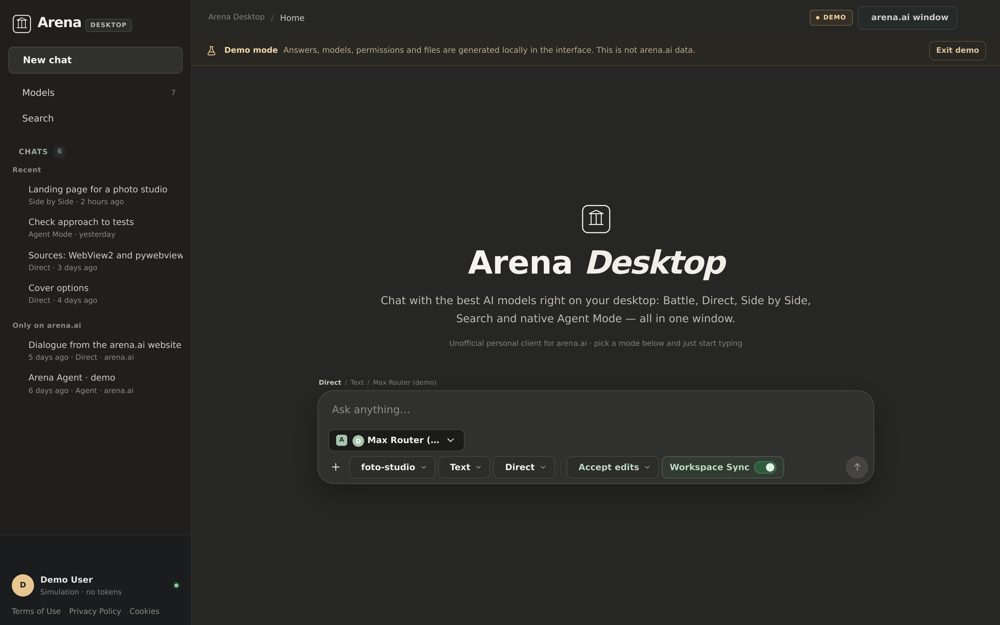
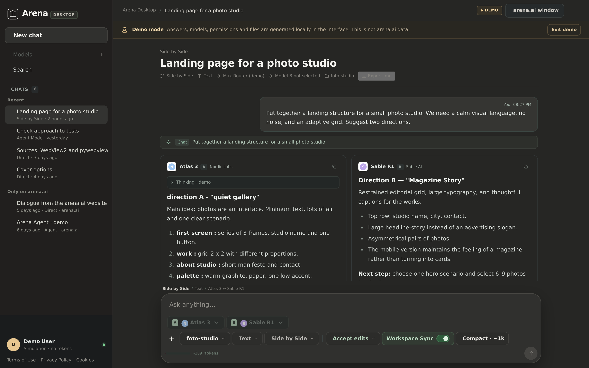
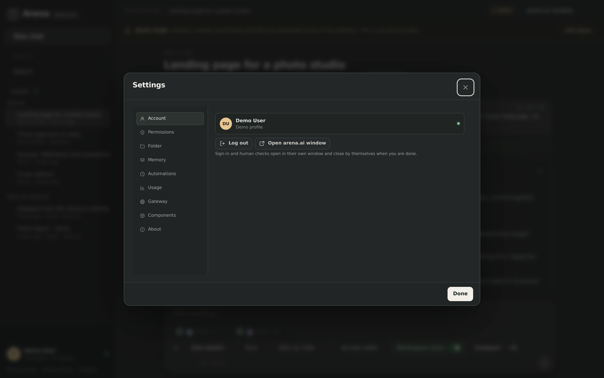
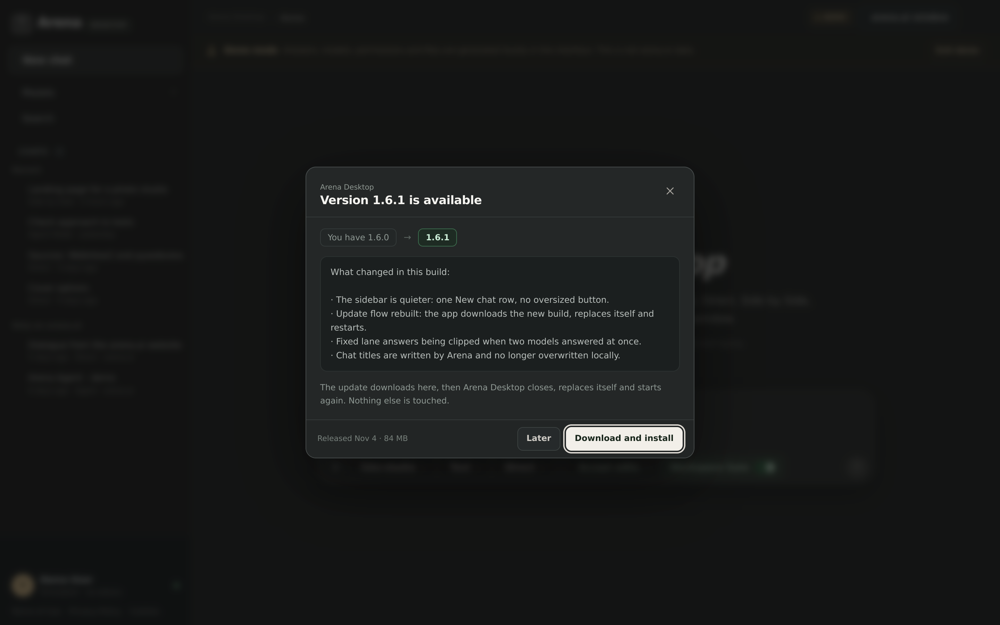
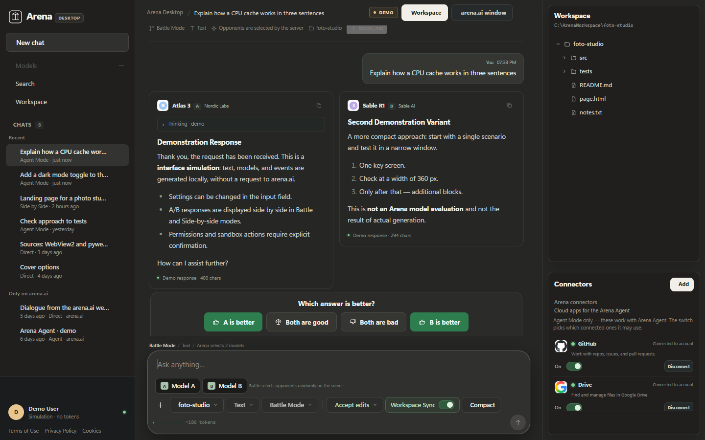
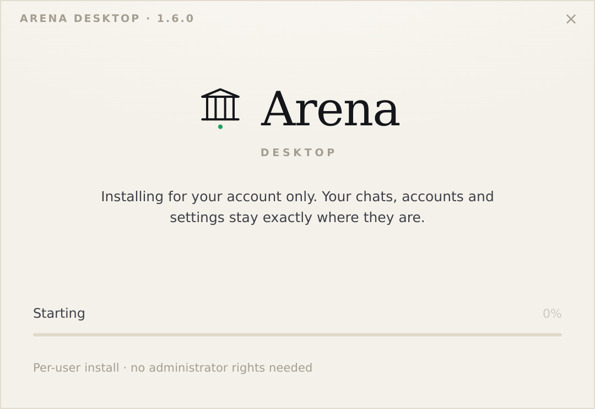
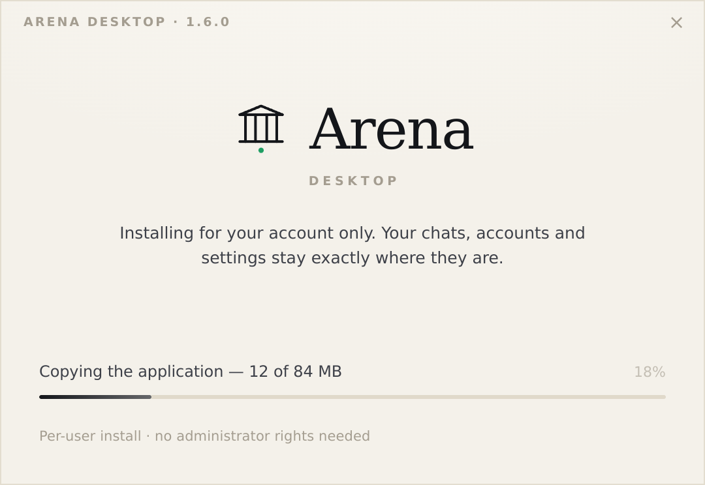
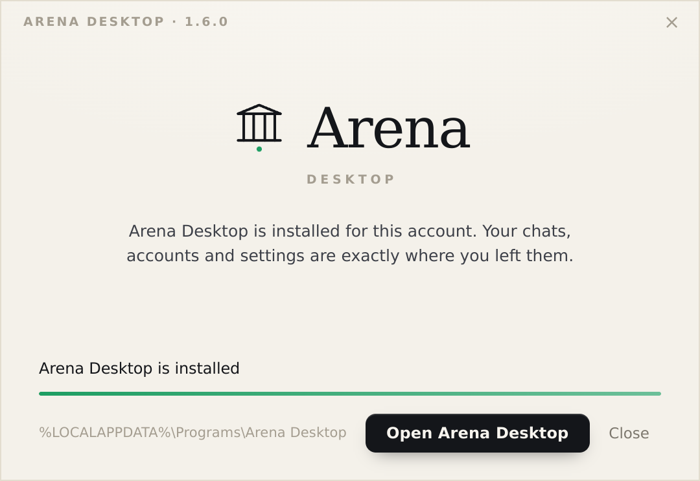

# Interface preview — the build before the 1.5.2 rework

Screenshots captured from demo mode at 1440×900 @2x (the setup window frames are
540×372 @2x, the real window size) from the build that became **1.5.2**, taken
**before** the sidebar and conversation rework.

They are kept as the "before" record: the oversized *New chat* block, the flat
*Models* / *Search* rows, the account block and the legal links at the bottom of
the rail are exactly what the 1.5.2 rail replaces. The current interface is
documented in [the rework notes](../../REWORK.md).

## Home

## Chat — Side by Side

## Settings

## Update dialog

## The Workspace panel

The right-hand column of that build. 1.5.2 removes it; the folder chooser and the
connectors stay, in the composer and in Settings.

## Setup window

| First screen | Copying files | Installed |
|---|---|---|
|  |  |  |

The window is per-user, takes no answers, and leaves `%USERPROFILE%\.arena-personal`
untouched — the three frames above are the whole flow.
